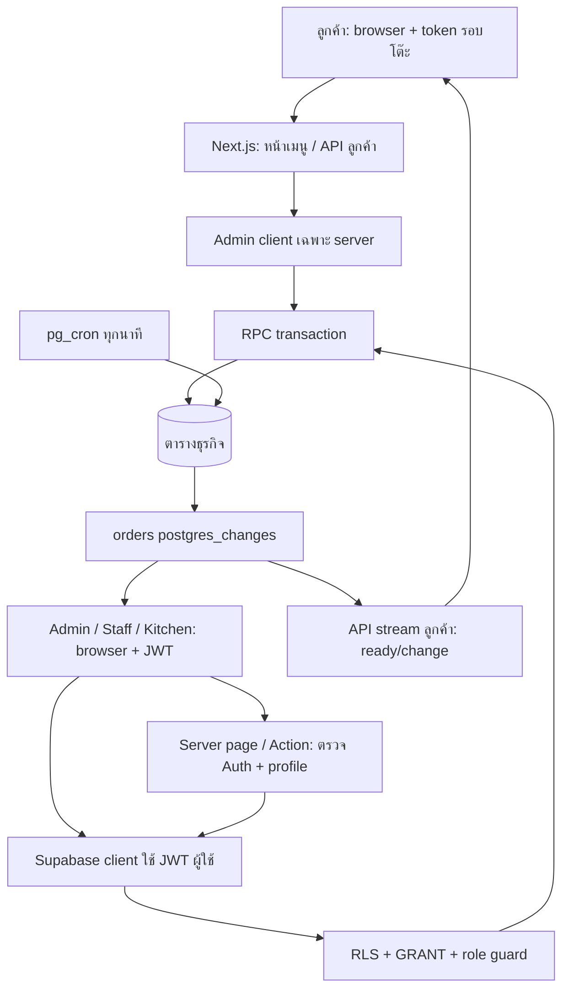
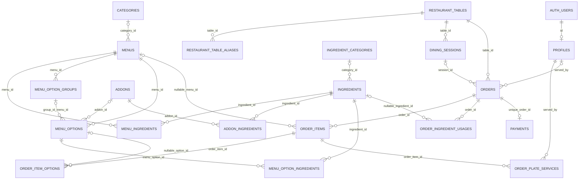
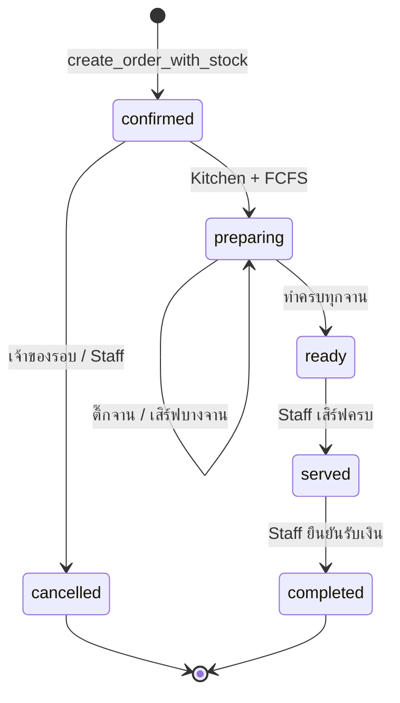
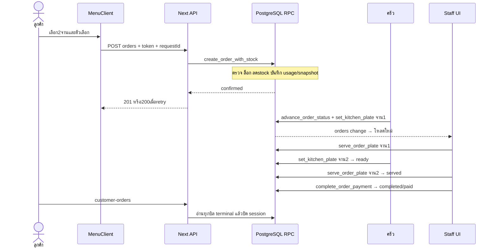

# คู่มือเตรียมสอบ Smart Order: จากหน้าจอถึงฐานข้อมูล

ตรวจวันที่ **26 ตุลาคม 2026 เวลาไทย** จากโค้ด commit `e9cdffbc49352d22d35f1c6d3ec67a65fb59bee5` และ metadata ของ Supabase ที่ link กับโปรเจกต์ เอกสารนี้ไม่แก้ source, migration, schema หรือข้อมูลธุรกิจ และไม่สร้างออเดอร์ทดสอบ

## วิธีอ่านและขอบเขตหลักฐาน

**[โค้ด]** คืออ่าน implementation ปัจจุบัน; **[ฐานจริง]** คือ SELECT metadata จาก Supabase ใน transaction `begin read only`; **[ตัวอย่างสมมติ]** คือตัวเลขสำหรับสอน ไม่ใช่ข้อมูลร้าน; **[เหตุผลเชิงออกแบบ]** คือประโยชน์ที่อธิบายได้จากโครงสร้าง ไม่ได้ยืนยันว่าเป็นเหตุผลเดิมของผู้พัฒนา

ใช้ `supabase/audit-clean-code.sql` และ query เสริมอ่าน Auth trigger, privileges, view options, indexes และ schema `catalog_backup` ผลดิบเก็บใน `.test-artifacts/exam-guide-live-schema.json` และ `.test-artifacts/exam-guide-extra.json` ที่ Git ignore ไม่คัดลอก credentials, tokens หรือแถวข้อมูลลูกค้าลงคู่มือ Query เสริมตรวจเวลา `2026-10-26 06:35:43 +07:00`

ตรวจว่า linked project ตรงกับ Supabase URL ที่แอปตั้งไว้ และ migration versions ในเครื่องตรงฐานจริงทั้ง 28 รายการ เทียบ body ของ function สำคัญ 11 ตัวกับ declaration ล่าสุดโดย normalize whitespace และรวมการปรับ role ของ payment แล้วตรงกัน ได้แก่ create_order_with_stock, advance_order_status, set_kitchen_plate, serve_order_plate, serve_order, save_ingredient, run_ingredient_stock_resets, guard_due_ingredient_stock, touch_ingredient_stock_version, restore_order_stock และ complete_order_payment ส่วน function เก่าที่ไม่มี declaration ใน repo ระบุข้อจำกัดไว้ตรงรายการ

[ฐานจริง] ใน `public` มี **20 ตาราง, 3 views, 37 functions, 42 policies, 12 user triggers, 103 constraints และ migration history 28 versions** เปิด RLS ทั้ง 20 ตาราง พบตารางสำรองอีก 3 ตารางใน `catalog_backup` และ Auth trigger 1 ตัวบน `auth.users` คำว่า “ทุกตาราง” ในเล่มหมายถึงตารางธุรกิจเหล่านี้ ไม่ได้ไล่ทุกตารางระบบภายใน Auth, Storage และ Realtime ของ Supabase

รอบนี้ **ไม่ login ใหม่ ไม่กดปุ่ม ไม่เรียก RPC ที่เขียน ไม่รัน hosted tests และไม่ตรวจ production URL** พฤติกรรมอธิบายจากโค้ดกับนิยามฐานจริง ไม่ใช่ผล end-to-end รอบใหม่ ผลทดสอบเก่าอ่านประกอบที่ [ผลตรวจฐานจริง](clean-code-hosted-verification.md) และ [Realtime/rollback](realtime-recovery-and-restore.md)

ลิงก์โค้ดมีเลขบรรทัดในป้ายและ `#L` สำหรับ GitHub ถ้า editor ไม่กระโดดตาม anchor ให้ใช้ Go to Line หรือค้นชื่อ function เลขบรรทัดอ้างอิง commit ข้างต้น

## บท 1 — ภาพรวมและศัพท์ที่ต้องเข้าใจ

ลูกค้าเปิด QR เลือกอาหารและตัวเลือก ส่งออเดอร์ ครัวทำตามคิว Staff เสิร์ฟรายจานและรับเงิน Admin จัดข้อมูลร้าน บัญชี และรายงาน **Admin ไม่ได้ทำงานครัวหรือรับเงินแทนทุกบทบาทได้** ในเวอร์ชันนี้

**Component** คือส่วนหน้าจอ React; **API route** คือ URL ฝั่ง server; **Server Action** คือ function server ที่ฟอร์มเรียก; **RPC** คือเรียก function PostgreSQL ผ่าน Supabase; **transaction** คือหลายการเขียนสำเร็จหรือยกเลิกทั้งชุด; **RLS** คือกฎสิทธิ์ระดับแถว; **FK** คือคอลัมน์เชื่อมตารางแม่; **snapshot** คือสำเนาข้อมูลตอนทำรายการ

เส้นทางลูกค้าใช้ API ตรวจ token แล้วเรียก service role บน server เส้นทางพนักงานเรียก RPC ด้วย JWT ของตนและตรวจบทบาทในฐาน ส่วน Server Actions จัด catalog ใช้ session Admin และ RLS ไม่ใช่ทุกปุ่มต้องผ่าน `/api`

**เปิดตาม:** [src/app/api/orders/route.ts:39](../src/app/api/orders/route.ts#L39) → [src/lib/supabase/admin.ts:4](../src/lib/supabase/admin.ts#L4) → `create_order_with_stock`; guard พนักงานเริ่มที่ [src/lib/dashboard-auth.ts:38](../src/lib/dashboard-auth.ts#L38)

**คำถามสอบ**

- ระบบแก้ปัญหาอะไร? — “เชื่อมคำสั่งซื้อ คิวครัว สต็อก การเสิร์ฟและรับเงินให้ใช้ข้อมูลชุดเดียวกันค่ะ”
- ทำไมไม่ทำทุกอย่างในหน้าเว็บ? — “คนปลอม request ได้ค่ะ กฎสำคัญจึงตรวจ server และฐานด้วย”
- อะไรเป็นข้อสันนิษฐาน? — “ประโยชน์ของโครงสร้างอธิบายได้ แต่เหตุผลเดิมที่ไม่ได้บันทึกจะไม่อ้างว่าเป็นข้อเท็จจริงค่ะ”

## บท 2 — เทคโนโลยีและโครงสร้าง

[โค้ด] [package.json](../package.json) ประกาศ Next.js `16.3.0`, React/React DOM `19.2.8`, Supabase JS `^2.112.1`, SSR `^0.12.4`, TypeScript `^5`, Tailwind `^4` เครื่องหมาย `^` เป็นช่วง dependency ไม่ใช่ยืนยัน patch ที่ติดตั้งทุกเครื่อง

| เทคโนโลยี | ใช้จริง | ประโยชน์/เหตุผลเชิงออกแบบ |
| --- | --- | --- |
| Next.js App Router | `app/**/page.tsx`, `api/**/route.ts` | รวม route หน้าเว็บกับงาน server ส่งข้อมูลเริ่มต้นให้ client view |
| React | ตะกร้า ฟอร์ม รายการสด | ใช้ state แสดงผลใหม่และแยก UI ใช้ซ้ำ |
| TypeScript | types ของ props/payload | ตรวจชนิดตอนพัฒนา แต่ต้อง validate JSON ตอนรันจริงด้วย |
| Tailwind/PostCSS | globals.css และ className | จัดหน้าจอ responsive ด้วย utility classes |
| PostgreSQL/Supabase | ตาราง FK CHECK RPC trigger | ข้อมูลสัมพันธ์ transaction และ locks |
| Supabase Auth/SSR | clients, server cookies, proxy | จัด JWT/session พนักงาน |
| Realtime | order observer และ customer stream API | แจ้งให้โหลดสถานะล่าสุด |
| qrcode | TableQRCode | URL โต๊ะเป็น PNG QR |
| pg_cron | job รีเซ็ต stock | ทำงานได้แม้ปิด browser |
| PGlite/Node test/Playwright | tests และ recovery script | ทดสอบ SQL/API และ browser ไม่ใช่ฐาน runtime ของร้าน |
| ESLint | eslint.config.mjs | ตรวจปัญหาโค้ดตามกฎ ไม่ยืนยัน business logic ทั้งหมด |

| ตำแหน่ง | หน้าที่ |
| --- | --- |
| `src/app` | URL, server pages, actions, API |
| `src/components` | ปุ่ม ฟอร์ม sidebar และ refresh |
| `src/lib` | loaders, validation, วันไทย, สถานะ, Supabase clients |
| `src/proxy.ts` | refresh cookie ของ dashboard ไม่ใช่ผู้ authorize สุดท้าย |
| `supabase/migrations` | ประวัติ schema/function ต้องอ่านฉบับล่าสุดและฐานจริง |
| `supabase/rollback` | SQL คืนวัตถุ cleanup เมื่อดำเนิน recovery |
| `supabase/audit-*.sql`, `verify-*.sql` | ตรวจ metadata/เงื่อนไข ไม่ใช่ flow ลูกค้า |
| `scripts`, `tests`, `fixtures` | ตรวจ สำรอง ทดสอบ บางไฟล์แตะ hosted ได้ ต้องอ่านก่อนรัน |
| `public` | static assets; image_url ของเมนูเป็น URL ไม่พบ flow upload ในหน้าที่ตรวจ |
| `docs` | เอกสารและหลักฐานสรุป |
| `.env.local`, `.test-artifacts`, `supabase/.temp` | การตั้งค่า/หลักฐานในเครื่องที่ไม่เข้า Git |

`layout.tsx` ตั้งภาษาไทย/metadata กราฟรายงานประกอบ SVG/HTML ใน `ReportsCharts` ไม่พบ dependency chart library แยก [src/components/reports-charts.tsx:7](../src/components/reports-charts.tsx#L7)

**คำถามสอบ**

- Next.js กับ React ต่างกันอย่างไร? — “React ทำหน้าจอ ส่วน Next.js จัด route และฝั่ง server ค่ะ”
- TypeScript กันข้อมูลปลอมได้เองไหม? — “ไม่ได้ค่ะ ต้องตรวจข้อมูลตอนรับ request ด้วย”
- ทำไมฐานสัมพันธ์? — “บิลมีรายการ สูตร และการจ่ายเงินเชื่อมกัน FK กับ transaction ช่วยรักษาความสอดคล้องค่ะ”

## บท 3 — หน้าจอ → ไฟล์ → function/API/RPC → ตาราง

`page.tsx` เป็นจุดเข้า URL ส่วน `view.tsx` ของครัว/Staff รับข้อมูลแรกจาก page แล้วโหลดใหม่ใน browser หน้าจัดการมี DashboardSidebar เมนูตามบทบาทอยู่ที่ [src/lib/dashboard-navigation.ts:4](../src/lib/dashboard-navigation.ts#L4)

| หน้าจอ/ผู้ใช้ | ไฟล์และ component | การเรียกจริง | ตารางที่เกี่ยวข้อง |
| --- | --- | --- | --- |
| `/` ทุกคน | [src/app/page.tsx:3](../src/app/page.tsx#L3) | Link ไป tables/login | ไม่ query |
| `/tables` ทุกคน | [src/app/tables/page.tsx:4](../src/app/tables/page.tsx#L4) | query, Link ใช้ table_number | restaurant_tables |
| `/login` พนักงาน | [src/app/login/page.tsx:19](../src/app/login/page.tsx#L19) | signInWithPassword → profile → dashboardHomeForRole | Auth, profiles |
| `/table/[tableId]` ลูกค้า | [src/app/table/[tableId]/page.tsx:12](../src/app/table/[tableId]/page.tsx#L12), MenuClient | resolveTableReference, loadCustomerMenuCatalog, addToCart/submitOrder → POST orders → create_order_with_stock | โต๊ะ/aliases, catalog, session, orders/items/options/usages/stock |
| `/table/[tableId]/orders` ลูกค้า | [src/app/table/[tableId]/orders/CustomerOrdersClient.tsx:55](../src/app/table/[tableId]/orders/CustomerOrdersClient.tsx#L55) | loadOrders → POST customer-orders; cancelOrder → cancel API; useCustomerOrderEvents | sessions, orders/items/options, menus; cancel แตะ usages/ingredients |
| `/table/[tableId]/queue` ลูกค้า | [src/app/table/[tableId]/queue/CustomerQueueClient.tsx:33](../src/app/table/[tableId]/queue/CustomerQueueClient.tsx#L33) | loadQueue → POST customer-queue ทุก 5 วินาทีเมื่อ visible/online | sessions, orders/items |
| `/dashboard` Admin | [src/app/dashboard/page.tsx:26](../src/app/dashboard/page.tsx#L26) | server queries พร้อมกัน | orders/payments/menus/ingredients/items/tables |
| `/dashboard/menus` Admin | [src/app/dashboard/menus/page.tsx:9](../src/app/dashboard/menus/page.tsx#L9), MenuAvailabilityForm, CatalogDeleteButton | toggleAvailability update; deleteCatalogItem → delete_catalog_item_safely | menus/categories/recipes/ingredients และ backup |
| `/dashboard/menus/new` Admin | [src/app/dashboard/menus/new/page.tsx:26](../src/app/dashboard/menus/new/page.tsx#L26), NewMenuRecipe, MenuAddonPicker | addMenu → create_menu_complete | menus/menu_ingredients/options/groups/addons |
| `/dashboard/menus/[id]/edit` Admin | [src/app/dashboard/menus/[id]/edit/page.tsx:88](../src/app/dashboard/menus/[id]/edit/page.tsx#L88), RecipeIngredientSelector, MenuAddonPicker | updateMenu → save_menu_with_addons; addIngredient/removeIngredient เขียน recipe ภายใต้ RLS | menus/categories/ingredients/recipes/options/groups/addons |
| `/dashboard/menus/[id]/options` Admin | [src/app/dashboard/menus/[id]/options/page.tsx:6](../src/app/dashboard/menus/[id]/options/page.tsx#L6) | guard แล้ว redirect edit?tab=info | ไม่ใช่ CRUD กลุ่มแยกแล้ว |
| `/dashboard/addons` Admin | [src/app/dashboard/addons/page.tsx:8](../src/app/dashboard/addons/page.tsx#L8), AddonEditor/Controls | saveAddon → save_addon; toggleAddon update; deleteAddon → delete_addon_safely | addons/addon_ingredients/ingredients/options/groups |
| `/dashboard/ingredients` Admin | [src/app/dashboard/ingredients/page.tsx:7](../src/app/dashboard/ingredients/page.tsx#L7), IngredientsClient, CatalogDeleteButton, OrderRealtimeRefresh | query stock/categories; delete RPC; orders push + ingredients polling | ingredients/categories/usages/recipes |
| `/dashboard/ingredients/new` Admin | [src/app/dashboard/ingredients/new/page.tsx:36](../src/app/dashboard/ingredients/new/page.tsx#L36), IngredientResetFields | readIngredientReset → save_ingredient | ingredients/ingredient_categories |
| `/dashboard/ingredients/[id]/edit` Admin | [src/app/dashboard/ingredients/[id]/edit/page.tsx:54](../src/app/dashboard/ingredients/[id]/edit/page.tsx#L54) | save_ingredient พร้อม expected_updated_at | stock/reset/version |
| `/dashboard/ingredients/categories` Admin | [src/app/dashboard/ingredients/categories/page.tsx:29](../src/app/dashboard/ingredients/categories/page.tsx#L29) | addCategory/updateCategory insert/update; deleteCategory → delete_ingredient_category_safely | ingredient_categories/ingredients |
| `/dashboard/tables` Admin | [src/app/dashboard/tables/TablesClient.tsx:29](../src/app/dashboard/tables/TablesClient.tsx#L29), TableQRCode | save → saveTable → manage_restaurant_table | restaurant_tables/aliases |
| `/dashboard/users` Admin | [src/app/dashboard/users/user-management.tsx:16](../src/app/dashboard/users/user-management.tsx#L16) | GET/POST/PATCH/DELETE admin/users → Auth Admin API + manage_staff_profile | Auth/profiles และ FK audit |
| `/dashboard/orders` Staff | [src/app/dashboard/orders/page.tsx:4](../src/app/dashboard/orders/page.tsx#L4), orders/view, OrderStatusTabs, UpdateOrderStatusButton | loadOrders; cancel API; useLiveOrderView | orders/items/options/tables/payments; history ใช้ status/date |
| `/dashboard/kitchen` Kitchen | [src/app/dashboard/kitchen/view.tsx:24](../src/app/dashboard/kitchen/view.tsx#L24), KitchenPlates | loadKitchenOrders; updateStatus → advance_order_status; toggle → set_kitchen_plate | orders.status/updated_at; items.completed_plates |
| `/dashboard/ready` Staff | [src/app/dashboard/ready/view.tsx:11](../src/app/dashboard/ready/view.tsx#L11), ServePlateButton, PlateProgress | loadReadyOrders; serve → serve_order_plate | orders/items/order_plate_services/profiles |
| `/dashboard/payments` Staff | [src/app/dashboard/orders/payments-view.tsx:11](../src/app/dashboard/orders/payments-view.tsx#L11), UpdateOrderStatusButton | loadPendingPayments; receivePayment → complete_order_payment | orders/payments |
| `/dashboard/reports` Admin | [src/app/dashboard/reports/page.tsx:33](../src/app/dashboard/reports/page.tsx#L33), ReportsCharts | query รายเดือน/รวมผลใน TypeScript ไม่มี RPC รายงาน | orders/items/options/payments/tables |
| access-denied / forbidden / dashboard error | [src/app/access-denied/page.tsx:4](../src/app/access-denied/page.tsx#L4), app/forbidden.tsx, dashboard/error.tsx | แจ้งสิทธิ์/โหลดล้มเหลว | ไม่ใช่ทางข้าม guard |

**คำถามสอบ**

- ปุ่มทุกตัวมี API ไหม? — “มีทั้ง Server Action และเรียก RPC ด้วย JWT ตรงค่ะ ส่วนลูกค้าใช้ API server เป็นหลัก”
- ตามปุ่มครัวอย่างไร? — “kitchen/view → UpdateOrderStatusButton → advance_order_status หรือ KitchenPlates → set_kitchen_plate ค่ะ”
- groups ยังใช้ไหม? — “ใช้จริงค่ะ route options เดิม redirect แล้ว แต่ loader/API/ฐานยังใช้กฎกลุ่ม”

## บท 4 — ตาราง ความสัมพันธ์ และ views

### ตารางแอปครบทั้ง 20 ตาราง

| ตาราง | เก็บอะไร/คอลัมน์สำคัญ | ผู้ใช้และความสัมพันธ์ |
| --- | --- | --- |
| categories | id/name/description/created_at | หมวดอาหาร → menus.category_id; ไม่พบหน้า CRUD หมวดอาหารเฉพาะ |
| ingredient_categories | name/display_order/is_active | Admin จัดหมวด → ingredients.category_id |
| ingredients | name/unit/stock_quantity/minimum_stock/updated_at/category_id/reset_* | Admin เติม/ตั้ง; order ลด; cancel คืน; cron reset |
| menus | name/price/category_id/description/image_url/is_available/catalog_key/timestamps | catalog เมนู; catalog_key ไม่ใช่เลขออเดอร์ |
| menu_ingredients | menu_id/ingredient_id/quantity_required | สูตรพื้นฐานต่อ 1 จาน เชื่อมเมนูกับวัตถุดิบ |
| addons | name/additional_price/category/max_quantity/is_available/display_order | ตัวเลือกกลาง meat/topping/portion ใช้หลายเมนู |
| addon_ingredients | addon_id/ingredient_id/quantity_required | สูตร add-on กลาง |
| menu_option_groups | menu_id/name/kind/selection_type/min_select/max_select/max_total_quantity/is_required/is_active | กฎเลือกของแต่ละเมนู |
| menu_options | menu_id/group_id/addon_id/name/additional_price/is_available/max_quantity/sort_order | link ตัวเลือกกลางหรือ option แบบเดิม; raw ราคา/ชื่ออาจเป็น placeholder |
| menu_option_ingredients | id/menu_option_id/ingredient_id/quantity_required | สูตร option เดิมที่ไม่ผูก addon |
| restaurant_tables | id/table_number/qr_code/status/created_at | QR ปัจจุบัน encode URL id ไม่ได้ encode คอลัมน์ qr_code โดยตรง |
| restaurant_table_aliases | table_number เป็น key / table_id FK | ชื่อโต๊ะเก่าสำหรับลิงก์เดิม |
| dining_sessions | id/table_id/access_token/status/opened_at/closed_at | รอบลูกค้า browser; orders.session_id ชี้มา ไม่ใช่ Auth |
| orders | id/order_number/table_id/session_id/status/total_amount/stock_deducted/dining_type/request_id/fingerprint/served_at/by/timestamps/note | หัวบิล; session หนึ่งมีหลายบิล; id เป็น UUID ต่างจากเลขแสดงผล |
| order_items | order_id/menu_id/quantity/unit_price/subtotal/snapshots/completed_plates/served_plates | quantity=2 คือสองจานใน item เดียว plate เริ่ม 1 ภายใน item |
| order_item_options | order_item_id/menu_option_id/option_name/additional_price/quantity/menu_option_id_snapshot | ตัวเลือกตอนสั่ง quantity เป็นจำนวนต่อจาน |
| order_ingredient_usages | order_id/ingredient_id/quantity_used/ingredient_*_snapshot | ยอดตัดจริงรวมต่อออเดอร์ ใช้คืนแม้สูตรเปลี่ยน |
| order_plate_services | PK(order_item_id,plate)/served_at/served_by | audit ผู้เสิร์ฟแต่ละจาน → profiles |
| payments | UNIQUE order_id/payment_method/amount/status/paid_at/created_at | การชำระหนึ่งแถวต่อบิลตาม constraint |
| profiles | id FK auth.users/full_name/role/is_active/created_at | สิทธิ์บัญชีร้าน ไม่เก็บ password |

### นอก public และรายการที่เลิกใช้

[ฐานจริง] `catalog_backup.before_redesign(table_name,rows,captured_at)` และ `before_hard_delete(table_name,rows,captured_at)` เป็นสำเนาระหว่าง migration เก่า; `hard_delete_events(id,deleted_at,actor_id,kind,catalog_id,name,snapshot)` บันทึกการลบ catalog ไม่มีหน้า CRUD ปกติ พบ RLS ปิดทั้งสาม จึงต้องพิจารณา schema/table grants แยก ไม่กล่าวว่า RLS เปิดทุก schema รอบนี้ไม่อ่านแถว backup

`auth.users` เป็นบัญชีบริการ Auth ใช้ id เชื่อม profiles; หน้า Admin เรียก Auth Admin API บน server ไม่อ่าน password กลับ ไม่ได้ไล่ตารางระบบ Auth ทุกตัว `reviews`, `deduct_ingredient_stock(jsonb)`, `process_order_stock(uuid,jsonb)` ไม่อยู่ในฐานปัจจุบัน ไฟล์ rollback เป็นประวัติ ไม่ใช่ flow ปัจจุบัน

### ER diagram

ภาพเป็น FK จริง ส่วน snapshot เป็นสำเนาไม่ใช่ FK ที่บังคับว่ารายการปัจจุบันต้องอยู่ `orders.session_id` nullable สำหรับข้อมูลเก่า แต่ flow ใหม่สร้าง/ใช้ session

ลบเมนูแล้วสูตร/groups/options ลูก CASCADE แต่ order_items.menu_id SET NULL เก็บประวัติ; ลบ option แล้ว order_item_options.menu_option_id SET NULL; ลบ ingredient แล้ว usages.ingredient_id SET NULL ขณะที่ชื่อ/หน่วย snapshot ยังอยู่ สูตรที่ใช้ ingredient ถูก CASCADE จึงปิดขายรายการที่กระทบก่อนลบ FK audit ผู้เสิร์ฟทำให้ลบบัญชีบางคนไม่ได้เสมอ การปิดบัญชีเป็นอีกทางที่รักษาประวัติ

### Views จริงทั้ง 3

- `menu_stock_availability`: สูตรพื้นฐานต้องมีและ stock ทุกตัวพอ 1 จาน พร้อม menus เปิดขายจึง can_order=true ไม่รับรองว่าพอทั้งตะกร้า และ view ไม่เช็ก reset_next_at
- `effective_menu_options`: addon_id มีค่าใช้ชื่อ/ราคา/max_quantity ของ addons; พร้อมใช้ต้องผ่าน flag ทั้ง link และ addon; option เดิมใช้ค่าตนเอง
- `effective_menu_option_ingredients`: option เดิมใช้สูตร menu_option_ingredients; ถ้าผูก addon ใช้ addon_ingredients แล้วคืนรูป menu_option_id เดียวกัน

[ฐานจริง] views ทั้งสาม `security_invoker=true` ใช้สิทธิ์ผู้เรียก ไม่ข้าม RLS เอง Loader ลูกค้าเรียกด้วย service role บน server แล้วส่งเฉพาะรูปเมนูที่จำเป็น [src/lib/customer-menu-catalog.ts:37](../src/lib/customer-menu-catalog.ts#L37)

**คำถามสอบ**

- แยก orders/items ทำไม? — “บิลเดียวมีหลายเมนู เก็บหัวบิลครั้งเดียวและรายการชี้กลับด้วย order_id ค่ะ”
- addons/options ต่างกันอย่างไร? — “addons เป็นข้อมูลกลาง ส่วน options ระบุว่าเมนูนี้เลือกอะไรได้และอยู่กลุ่มไหนค่ะ”
- ลบเมนูแล้วประวัติหายไหม? — “FK เป็น null แต่ชื่อ/ราคาตอนสั่งเก็บ snapshot ค่ะ”
- menu_price_snapshot เป็นราคาไหน? — “capture_catalog_history เก็บจาก unit_price รวมตัวเลือกค่ะ”

## บท 5 — QR, ตัวตนลูกค้า, เมนู และตะกร้า

### QR ระบุโต๊ะ ไม่ได้ระบุตัวบุคคล

TablesClient ส่ง `tableId=id-<id>` ให้ TableQRCode สร้าง `${window.location.origin}/table/${tableId}` ด้วย QRCode.toDataURL และดาวน์โหลด PNG เปลี่ยนชื่อโต๊ะจึงไม่เปลี่ยน id ใน QR ใหม่ [src/components/TableQRCode.tsx:18](../src/components/TableQRCode.tsx#L18); [src/app/dashboard/tables/TablesClient.tsx:106](../src/app/dashboard/tables/TablesClient.tsx#L106)

TablePage รับ `id-เลข` หรือเลขล้วน resolveTableReference แยก primary key ตรงกับ numeric alias เดิมแล้วตรวจโต๊ะ/สถานะ inactive เลขป้ายไม่จำเป็นต้องเท่า primary key

**ข้อจำกัด:** `/tables` สร้าง Link จาก table_number แต่ resolver รับ legacy เฉพาะเลขบวก หาก Admin ตั้งชื่อโต๊ะเป็นข้อความ Link หน้ารวมอาจไม่เข้าเมนู แม้ QR แบบ id ใช้ได้ QR/URL โต๊ะยังไม่พิสูจน์ว่าผู้เปิดนั่งอยู่ที่ร้าน ไม่แก้ในงานเอกสารนี้

### token ของรอบโต๊ะ

`getOrCreateSessionToken` อ่าน localStorage key `smart-order-session-id-<tableId>` และ fallback `smart-order-session-<legacyReference>` ถ้าไม่มี UUID ที่ถูกต้องสร้าง crypto.randomUUID หากมี token เก่า POST customer-orders ตรวจว่ารอบ closed หรือไม่ ถ้า network ล้มเหลวจะไม่เริ่มรอบใหม่เอง

ใช้ navigator.locks เมื่อ browser รองรับ เพื่อลดการต่ออายุรอบชนกันระหว่าง tabs; ถ้าไม่รองรับใช้ fallback ใน tab นั้น **คนละมือถือที่สแกนโต๊ะเดียวกันไม่ได้ถูกทำเป็น session เดียวกันอัตโนมัติ** ลูกค้าไม่ใช้ Supabase Auth คนรู้ token มีสิทธิ์รอบนั้นตาม API guard

session row สร้างใน create_order_with_stock_internal ตอนสั่งสำเร็จ ไม่ได้สร้างเพียงเพราะเปิด QR/เพิ่มตะกร้า [src/app/table/[tableId]/MenuClient.tsx:99](../src/app/table/[tableId]/MenuClient.tsx#L99)

### โหลดเมนูและกฎ

loadCustomerMenuCatalog บน server อ่าน menus เปิดขาย, categories, availability, active groups, effective options/recipes แล้วคำนวณ option ที่พอจาก stock หลังกันสูตรพื้นฐาน 1 จาน จำกัดด้วย max_quantity กฎกลุ่มมี min/max จำนวนชนิดและ max_total_quantity; can_order รวม availability กับตัวเลือกกลุ่มบังคับที่พอ

ข้อมูลนี้เป็น snapshot ตอนโหลด ไม่จอง stock เมื่อหลายคนสั่งหรือเพิ่มจำนวนต้องตรวจ API/DB อีกครั้ง

### ตะกร้าและ submit

openMenuOptions เปิดฟอร์ม, selectedOptionQuantities เก็บจำนวนต่อ option, addToCart ตรวจกลุ่มแล้วสร้าง CartItem มี cartId/menuId/quantity/options/ราคาแสดงผล editCartItem/increaseCartQuantity/decreaseCartQuantity/removeCartItem แก้ React state ยังไม่เขียนฐาน

ตะกร้าไม่พบ persist ลง localStorage/ฐาน จึงหายเมื่อ reload ได้ แต่ token ยังอยู่ submitOrder ใช้ ref submitting ล็อกทันที pendingRequest จับ payload/requestId เดิมเมื่อ network/server ล้มเหลว หลัง 4xx จึงปล่อย request เมื่อสำเร็จล้าง cart และไป orders PendingRequest อยู่ใน memory ไม่รับรอง dedup ข้าม reload

**เปิดตาม:** [src/app/table/[tableId]/MenuClient.tsx:230](../src/app/table/[tableId]/MenuClient.tsx#L230), [src/app/table/[tableId]/MenuClient.tsx:348](../src/app/table/[tableId]/MenuClient.tsx#L348)

**คำถามสอบ**

- ลูกค้า login ไหม? — “ใช้ UUID token ของรอบใน browser แล้ว API ตรวจคู่กับโต๊ะค่ะ”
- โต๊ะเดียวกันเห็นรายการเดียวกันทุกมือถือไหม? — “ไม่อัตโนมัติค่ะ token เป็นของแต่ละ browser”
- ราคาตะกร้าเชื่อได้ไหม? — “ใช้แสดงผลค่ะ server และฐานอ่านราคาปัจจุบันตรวจอีกครั้ง”

## บท 6 — ส่งออเดอร์ ตรวจราคา สูตร และหักสต็อก

### API ฝั่ง server

POST orders ตรวจ JSON/tableId/UUID token-requestId/diningType จำนวนจานเต็มบวก option quantity 1–3 และไม่ซ้ำ note ตัดไม่เกิน 500 ตัว Browser ส่ง IDs/จำนวน ไม่ส่งราคาให้ server ยอมรับเอง

API สร้าง SHA-256 ของโต๊ะ token วิธีรับ รายการและ note เป็น request_fingerprint ถ้ามี request_id เดิม fingerprint ตรงคืนบิลเดิม 200 ถ้าต่างคืน 409 จากนั้นอ่านโต๊ะ/session/menus/effective options ตรวจ option เป็นของเมนู กฎกลุ่ม เปิดขายและสูตรครบ

วัตถุดิบพื้นฐาน = quantity_required × จำนวนจาน; วัตถุดิบตัวเลือก = quantity_required × จำนวนตัวเลือกต่อจาน × จำนวนจาน รวม ingredient ID เดียวกันข้ามรายการ ตรวจ stock เพื่อแจ้งข้อความง่าย คิดเงิน API ในหน่วยสตางค์ด้วย Math.round(price*100) แล้วแปลงเป็นบาทลดปัญหา binary decimals

**จุดเปิดตาม:** [src/app/api/orders/route.ts:187](../src/app/api/orders/route.ts#L187), [src/app/api/orders/route.ts:406](../src/app/api/orders/route.ts#L406), [src/app/api/orders/route.ts:594](../src/app/api/orders/route.ts#L594), [src/app/api/orders/route.ts:636](../src/app/api/orders/route.ts#L636)

### RPC ตรวจซ้ำใน transaction

create_order_with_stock รับเฉพาะ service_role ล็อกตาม requestId กันคำขอเดียวกันแทรกพร้อมกัน ล็อก token กันสร้าง session ครั้งแรกซ้ำ ล็อก catalog แบบ SHARE กันสูตร/ราคาเปลี่ยนระหว่างตรวจ แล้วตรวจราคา options/groups/สูตรใหม่ในฐาน

ตรวจ unit_price และรายละเอียด option ตรง catalog สร้าง v_required จากสูตรจริง **ไม่ได้ใช้ p_required_items ที่รับมาเป็นคำตอบสุดท้าย** จากนั้นเรียก internal แล้วตรวจ postcondition ว่าตัด stock แล้วและ usages ตรงสูตรที่คำนวณ

internal ทำตามลำดับ: ตรวจ/สร้าง dining_session → INSERT orders confirmed/stock_deducted=false → INSERT items/options → ไล่ ingredient_id แล้ว conditional UPDATE stock → INSERT usages → stock_deducted=true ถ้าขั้นใด exception rollback ทั้งบิล รายการ session ที่เพิ่งสร้างและ stock

`UPDATE ingredients SET stock_quantity=stock_quantity-... WHERE stock_quantity>=...` ตรวจและลดภายใต้ row lock สองเครื่องแย่งจานสุดท้ายต้องรอกันและตรวจยอดหลังรายการก่อนหน้า CHECK stock_quantity>=0 เป็นอีกชั้น เรียง ingredient_id ลดโอกาสล็อกสวน ไม่รับรองว่าไม่มี deadlock/timeout ทุกกรณี

### Trigger เก่าไม่ตัดซ้ำเพราะอะไร

[ฐานจริง] trigger_deduct_order_stock เป็น BEFORE UPDATE OF status แต่ทำเฉพาะเปลี่ยนจากสถานะอื่น **เข้า confirmed** และยังไม่ deducted Flow ใหม่ INSERT confirmed เลย ตัดด้วย internal แล้ว UPDATE stock_deducted ตอนท้ายไม่ได้เข้า confirmed ใหม่ ตอนเริ่มครัว confirmed→preparing ก็ไม่ตรงเงื่อนไข ห้ามอธิบายว่าทุกบิลถูก trigger นี้ตัด stock

[supabase/migrations/20260915123000_order_stock_guards.sql:7](../supabase/migrations/20260915123000_order_stock_guards.sql#L7); internal เคย rename จาก function เดิม ดูภาคผนวก RPC ส่วน declaration deduct_order_stock ไม่พบใน migrations ปัจจุบัน ยืนยันนิยามจากฐานตรง

**คำถามสอบ**

- สั่งจานสุดท้ายพร้อมกัน? — “ฐานลดแบบมีเงื่อนไขและล็อกแถว คนยอดไม่พอ rollback ทั้งออเดอร์ค่ะ”
- ตรวจ API แล้วทำไมตรวจ DB อีก? — “ระหว่างอ่านกับเขียนอาจมีคนสั่งหรือแก้สูตร จึงตรวจใน transaction อีกค่ะ”
- response หาย retry ทำไมไม่ตัดซ้ำ? — “ใช้ requestId/fingerprint เดิม มี unique index และ advisory lock แล้วคืนบิลเดิมค่ะ”
- pending ยังมีไหม? — “constraint รองรับของเก่า แต่ flow ใหม่สร้าง confirmed เลยค่ะ”

## บท 7 — ยกเลิกและคืน stock

CustomerOrdersClient.cancelOrder ส่ง tableId/token ไป `/api/orders/[orderId]/cancel` API ตรวจ token ของ active session, โต๊ะ และ order อยู่ session จริง Staff ส่ง body ว่างแต่ต้อง getUser และ profile active/role=staff Admin/Kitchen ไม่ผ่านเส้นทางนี้

API เรียก cancel_order_and_restore_stock ด้วย service role และ expected **confirmed** ฐาน lock order แล้วตรวจ status ดังนั้นหน้าปัจจุบันยกเลิกก่อนเริ่มทำเท่านั้น แม้ RPC มีสถานะเก่าที่กว้างกว่า ถ้าครัวเริ่มก่อน cancel ไม่ผ่าน expected ถ้า cancel ก่อนครัวเริ่มไม่ได้

RPC เปลี่ยนเป็น cancelled แล้ว trigger_restore_order_stock → restore_order_stock คืนจาก **usages.quantity_used เดิม** ไม่อ่านสูตรใหม่ กำหนด stock_deducted=false เก็บ items/options/usages ไว้ ถ้าไม่มี usage หรือ ingredient detach จะปฏิเสธแทนคืนยอดเดา

คืนเฉพาะเปลี่ยนเข้า cancelled ครั้งแรกและ old.stock_deducted=true retry หลัง cancelled เป็น conflict ไม่คืนซ้ำ ไม่ใช่ refund และไม่พบหน้าคืนเงินหลัง completed

**เปิดตาม:** [src/app/api/orders/[orderId]/cancel/route.ts:16](../src/app/api/orders/[orderId]/cancel/route.ts#L16), [supabase/migrations/20260915010000_admin_hard_delete_snapshots.sql:173](../supabase/migrations/20260915010000_admin_hard_delete_snapshots.sql#L173)

**คำถามสอบ**

- แก้สูตรก่อน cancel คืนยอดไหน? — “คืน usage ตอนตัดจริงค่ะ”
- ครัวเริ่มพร้อม cancel? — “ล็อก order และเช็กสถานะ ฝั่งทำทีหลังเห็นสถานะเปลี่ยนแล้วจะถูกปฏิเสธค่ะ”
- completed cancel ได้ไหม? — “API รับเฉพาะ confirmed และยังไม่มี refund flow ค่ะ”

## บท 8 — FCFS, ทำเสร็จรายจาน และเสิร์ฟบางส่วน

### คิวครัว

loadKitchenOrders เรียง created_at→order_number→id UI ใช้ firstPendingOrder/hasPreparingOrder disabled ปุ่มคิวหลัง ฐานบังคับจริงใน advance_order_status ตรวจ role=kitchen_staff, transition, expected status, advisory lock กลาง `(20261025,1)` และ row lock order

เริ่ม preparing ต้องเป็นตัวแรกใน confirmed/preparing และไม่มี order อื่น preparing จึงทำครั้งละหนึ่งบิล **ปล่อยคิวเมื่อทำครบเป็น ready ไม่ต้องรอเสิร์ฟ/รับเงิน**

หน้าคิวลูกค้าเป็นการแสดงผล ไม่ใช่ผู้ตัดสิน FCFS customer-queue รวม confirmed/preparing/ready เรียง created_at→id ส่ง queueNumber/status/created_at/isMine/partiallyServed ไม่ส่งรายการอาหาร ราคา หรือ token โต๊ะอื่น ไม่รับรอง ETA

### ติ๊กเสร็จ

KitchenPlates สร้าง checkbox 1..quantity ต่อ item toggle เรียก set_kitchen_plate(itemId,plate,checked) ไม่ส่ง “เพิ่มเสร็จอีกหนึ่ง” เพราะ retry ต้องอ้างจานเดิม

RPC ใช้ advisory lock เดียวกับ FCFS และ lock order/item ตรวจ role/เลขจาน completed=true ของจานที่เสร็จแล้ว return ไม่ append ซ้ำ จานเสิร์ฟแล้ว undo ไม่ได้ ตอนเขียนต้อง preparing เพิ่ม/ลบเลขใน completed_plates แล้วเมื่อทุก item ครบ quantity เปลี่ยน status ready **อัตโนมัติ** และ updated_at ให้ Realtime

### เสิร์ฟขณะ preparing ได้

pendingPlates = completed ลบ served และเรียงเลข loadReadyOrders อ่าน preparing/ready ที่มีจานรอ ไม่รอทั้งบิล ready เสมอ ServePlateButton.serve → serve_order_plate ตรวจ staff, lock order/item, จาน completed และยังไม่ served, order preparing/ready และตัด stock แล้ว

เขียน order_plate_services พร้อม auth.uid() แล้ว append served_plates เมื่อทุก item เสิร์ฟครบเป็น served และเก็บ served_at/by ระดับบิล retry จานเดิม return ไม่เสิร์ฟจานถัดไปแทน PK(item,plate) กัน audit ซ้ำ CHECK items ตรวจเลขถูกช่วง/ไม่ซ้ำ/served เป็น subset ของ completed

**partially_served เป็นสถานะแสดงผล** จาก orderDisplayStatus เมื่อ preparing/ready และมี served_plates ไม่ใช่ค่าใน orders.status ส่วน serve_order(uuid) ยังรองรับทั้งบิล/terminal เดิม ต้องทำครบแล้ววน serve_order_plate ของจานที่เหลือ จึงใช้ audit แบบเดียวกัน หน้าพร้อมเสิร์ฟปัจจุบันใช้รายจาน

**เปิดตาม:** [src/components/kitchen-plates.tsx:14](../src/components/kitchen-plates.tsx#L14), [src/components/serve-plate-button.tsx:12](../src/components/serve-plate-button.tsx#L12), [src/lib/plate-progress.ts:7](../src/lib/plate-progress.ts#L7), [supabase/migrations/20261025010000_partial_plate_service.sql:54](../supabase/migrations/20261025010000_partial_plate_service.sql#L54), [supabase/migrations/20261025000000_kitchen_fcfs_plates.sql:9](../supabase/migrations/20261025000000_kitchen_fcfs_plates.sql#L9)

**คำถามสอบ**

- disabled ปุ่มพอไหม? — “ต้องตรวจลำดับและ lock ในฐานด้วยค่ะ”
- preparing เสิร์ฟได้ไหม? — “เฉพาะจาน completed แล้วค่ะ”
- partially_served เก็บไหน? — “คำนวณจาก status กับ served_plates ไม่ใช่ status ใหม่ค่ะ”
- เริ่มบิลต่อไปเมื่อไร? — “ทำครบเป็น ready ค่ะ ไม่รอเงิน”

## บท 9 — รับเงิน ปิดบิล ประวัติ และรายงาน

loadPendingPayments อ่าน served และ filterUnpaidOrders กรองบิลชำระแล้ว receivePayment(cash/qr_code) เรียก complete_order_payment ด้วย JWT Staff ฐานตรวจ role/lock order/served/deducted และห้ามมี payment ไม่ใช่ failed จากนั้น INSERT paid amount จาก orders.total_amount และ UPDATE completed ใน transaction เดียว

**รับเงินไม่ลด stock อีก** ตัดแล้วตอนสร้างบิล served_at/by ยังเก็บการส่งมอบแยกจาก paid_at มี UNIQUE payments.order_id แม้ function ข้าม failed แต่ constraint ยังจำกัดหนึ่งแถว จึงไม่อ้างว่ามี gateway retry flow ครบ

**QR โต๊ะกับ QR ชำระต่างกัน:** TableQRCode สร้าง URL เมนู ส่วนปุ่มรับเงิน QR Code บันทึก payment_method=qr_code ไม่พบ dynamic payment QR, ธนาคาร, ตรวจสลิป, webhook หรือยืนยันเงินเข้าอัตโนมัติ Staff เป็นผู้ยืนยัน

### completed ของบิล กับ closed ของรอบ

complete_order_payment เปลี่ยน order completed ไม่ได้ปิด session โดยตรง POST customer-orders อ่านรอบแล้วถ้าทุกบิล completed/cancelled จึง UPDATE dining_sessions closed และคืน orders ว่าง นี่คือ endpoint อ่านที่ **มี side effect ปิดรอบ** รอบนี้จึงไม่เรียก endpoint นี้สำรวจฐาน

ลูกค้าเห็น activeOrders ไม่ใช่ประวัติถาวร หลัง closed ล้าง key token หลัก/หยุด polling ครั้งใหม่ MenuClient ตรวจสร้าง token รอบใหม่

### ประวัติและรายงานใช้เวลาใด

Staff เปิด orders?status=history หรือ completed/cancelled ผ่าน loadOrders กรอง **updated_at** ตามวันไทยจาก bangkokDayRange ยอดประวัติรวม payments paid ของ completed ในช่วงนั้น ไม่ใช่ยอดสร้างบิลวันนี้

Dashboard นับบิลสร้างวันนี้จาก created_at, preparing ปัจจุบัน, menus เปิดขาย, stock<=minimum และยอด payments สำเร็จ paid_at วันนี้ deduplicate ต่อ order

ReportsPage รับ month ใช้ bangkokMonthRange อ่าน completed ตาม updated_at และ payments ตาม paid_at แล้วใช้เฉพาะ completed ที่มี payment สำเร็จในชุดเดือน ยอดรวมใช้ payments.amount เมนูขายดีใช้ quantity/subtotal รวมตัวเลือก Add-on แยกใช้ชื่อ/ราคา snapshot × option.quantity × item.quantity เมนู snapshot ชื่อเดียวกันรวมด้วยชื่อ ไม่ได้แยก ID เสมอ

daily chart อิง paid_at ส่วน dining breakdown นับ orders.created_at จึงไม่จำเป็นต้องมีตัวหารเท่ากัน รายงานไม่ใช่กำไร ไม่พบต้นทุนซื้อ ภาษี ส่วนลด/refund ครบชุด หากแก้ updated_at ของ completed ภายหลังอาจเปลี่ยนเดือนที่ถูกจัดเข้า

**เปิดตาม:** [src/components/update-order-status-button.tsx:149](../src/components/update-order-status-button.tsx#L149), [supabase/migrations/20260923100000_served_order_payment.sql:36](../supabase/migrations/20260923100000_served_order_payment.sql#L36), [src/app/api/customer-orders/route.ts:78](../src/app/api/customer-orders/route.ts#L78), [src/lib/order-views.ts:73](../src/lib/order-views.ts#L73), [src/app/dashboard/reports/page.tsx:154](../src/app/dashboard/reports/page.tsx#L154)

**คำถามสอบ**

- ready/served/completed ต่างกัน? — “ทำครบ ส่งมอบครบ และรับเงินค่ะ”
- QR จ่ายอัตโนมัติไหม? — “Staff บันทึกวิธีจ่าย ยังไม่เชื่อมธนาคารค่ะ”
- ปิดบิลปิดรอบทันทีไหม? — “บิล completed ก่อน ส่วนรอบปิดเมื่อ customer-orders ตรวจว่าทุกบิลสิ้นสุดแล้วค่ะ”
- ยอดประวัติกับวันนี้ต่างได้ไหม? — “ใช้เวลาต่างกัน ทั้งสร้าง ปรับสถานะ และชำระค่ะ”

## บท 10 — Auth, RLS และการแยกบทบาท

### ตรวจตัวตนพนักงาน

LoginPage signInWithPassword แล้วอ่าน active profile ชี้หน้า admin→dashboard, staff→orders, kitchen_staff→kitchen Guard server ใช้ getVerifiedProfile ทำ getUser กับ profile ภายใต้ JWT พร้อมกัน ต้อง user ที่ตรวจได้และ profile.id ตรงกัน ไม่เชื่อ role ใน user_metadata ที่แก้ได้

server client ใช้ cookies, browser ใช้ SSR browser client proxy refresh/persist cookie ของ dashboard ใช้ getSession เพื่อ refresh **ไม่ใช้ผลนั้น authorize** pages/actions ยัง getUser+profile React cache อยู่ระดับ request/render ไม่ cache สิทธิ์ข้ามผู้ใช้

| งาน | Admin | Staff | Kitchen | ลูกค้า |
| --- | --- | --- | --- | --- |
| catalog/stock/tables/reports/users | ได้ตามกฎ | หน้าไม่อนุญาต | หน้าไม่อนุญาต | ไม่ได้ |
| หน้ารวม orders/history/ready/payments | หน้าถูกแยก ไม่เปิด Admin | ได้ | ไม่ใช่หน้า Kitchen | API รอบตน/คิวที่ตรวจ token |
| เริ่มทำ/ติ๊กเสร็จ | RPC ปฏิเสธ | RPC ปฏิเสธ | ได้ | ไม่ได้ |
| เสิร์ฟ/รับเงิน | RPC ปฏิเสธ | ได้ | RPC ปฏิเสธ | ไม่ได้ |
| cancel confirmed ผ่าน API | เส้นทาง Staff ปฏิเสธ | ได้ | ปฏิเสธ | รอบตนเท่านั้น |

**แยกสิทธิ์หน้าออกจาก SELECT:** [ฐานจริง] policies orders/items/payments/catalog หลายตารางใช้ is_active_shop_user ซึ่งอนุญาต active shop users ทั้งสาม role จึงไม่จริงที่ว่า Admin อ่านออเดอร์ใน DB ไม่ได้ หน้าแยกเข้มกว่า SELECT บางส่วน ส่วน mutation ครัว/เงินบังคับ role เฉพาะใน RPC

### GRANT, RLS และ function guard

current_shop_role อ่าน profiles ตาม auth.uid และ is_active; is_catalog_admin เทียบ admin; is_active_shop_user ตรวจมี role ปัจจุบัน Policy ต้องอ่านคู่กับ table/column privilege service_role/owner มีอำนาจข้าม RLS Functions SECURITY DEFINER ต้องมี guard/EXECUTE/search_path ส่วน catalog RPC บางตัวเป็น SECURITY INVOKER ใช้ RLS ของ Admin

[ฐานจริง] policies anon ชื่อเก่าบางตัวเหลือ เช่น customer_can_create_orders/items, Public can create order item options; grants หลายตารางกว้างรวม TRUNCATE บางตาราง **TRUNCATE ไม่ใช่ operation ที่ RLS ตรวจแถว** รอบนี้ไม่ทดสอบการเข้าถึง SQL/PostgREST ของ grants เหล่านี้ จึงไม่อ้างว่า “ไม่มีเส้นทางอื่นนอกจาก API” ไม่แก้สิทธิ์ในงานคู่มือ

anon มี SELECT policies บาง catalog/ingredients/recipes/order_items แต่ไม่มี SELECT policy เปิด orders ทั้งร้าน และไม่มี policy dining_sessions เปิด token ต้องไม่พูดว่า anon อ่านทุกตารางไม่ได้ หรืออ่านได้ทุกอย่างเพราะมี GRANT อย่างเดียว

### จัดการผู้ใช้

UserManagement → admin/users API → activeAdminId ตรวจ verified profile ทุกคำขอ GET รวม Auth users กับ profiles บน server POST สร้าง Auth user แล้ว manage_staff_profile; on_auth_user_created บน auth.users เรียก handle_new_user สร้าง profile เริ่ม staff **inactive** ไม่ให้สมัครเองได้สิทธิ์ร้านทันที

manage_staff_profile เป็น service-role RPC รับ actor/target แต่ตรวจ actor active admin อีกในฐาน ใช้ lock กลางรักษา Admin คนสุดท้ายและ row locks API กันปิด/ลดสิทธิ์/ลบตัวเอง ปิดบัญชีเขียน is_active=false ก่อน Auth ban ให้ JWT เดิมถูก RLS/RPC ปฏิเสธ เปิดใหม่ unban แล้วแก้ profile สองบริการไม่ใช่ SQL transaction เดียว ถ้า profile สร้างไม่สำเร็จพยายามลบ Auth ที่เพิ่งสร้างและแจ้งผล

deleteUser ยืนยันอีเมล ตรวจ self/last admin ปิด profile แล้ว Auth delete ถ้าล้มเหลวพยายามคืน active เดิม FK audit อาจทำให้ลบไม่ได้ ไม่พบ audit log ทุก action ของ Admin มี audit เฉพาะเสิร์ฟ/ลบ catalog เป็นต้น

**เปิดตาม:** [src/lib/supabase/verified-profile.ts:7](../src/lib/supabase/verified-profile.ts#L7), [src/proxy.ts:4](../src/proxy.ts#L4), [src/app/api/admin/users/route.ts:13](../src/app/api/admin/users/route.ts#L13), [src/app/api/admin/users/route.ts:90](../src/app/api/admin/users/route.ts#L90), [supabase/migrations/20260918100000_active_shop_accounts.sql:80](../supabase/migrations/20260918100000_active_shop_accounts.sql#L80)

**คำถามสอบ**

- ซ่อนเมนูพอไหม? — “ต้อง guard server และ DB เพราะส่ง request เองได้ค่ะ”
- ปิดบัญชี JWT เก่ายังใช้ได้ไหม? — “กฎที่ผูก helper อ่าน is_active ปัจจุบัน จึงปฏิเสธแม้ JWT ยังไม่หมดค่ะ”
- Admin ทำทุกอย่างไหม? — “เวอร์ชันนี้แยกจัดร้าน/ครัว/เงินให้ role เฉพาะค่ะ”
- ปลอดภัยทุกช่องทางหรือยัง? — “รับรองไม่ได้ค่ะ อ่านพบ grants/policies เก่าที่ต้อง audit แยก ไม่ได้ทำ penetration test”

## บท 11 — Realtime, รอ Auth, polling และ reconnect

### พนักงานฟังอะไร

[ฐานจริง] publication supabase_realtime มี public.orders ตารางเดียวสำหรับงานนี้ ไม่พบ items/ingredients ใน publication ที่ตรวจ OrderRealtimeRefresh ฟัง postgres_changes event `*`, schema public, table orders ดังนั้นติ๊กจานเขียน items แล้ว RPC ต้อง UPDATE orders.updated_at เพื่อให้จออื่นโหลด item ใหม่

channelName ต่อ crypto.randomUUID ต่ออายุ effect กัน cleanup ของ instance เก่าลบ subscription ใหม่ เริ่ม polling ก่อน แล้ว **await supabase.realtime.setAuth() ก่อน channel.subscribe** รอ cookie-backed Auth พร้อมให้ join ด้วย JWT ถ้า join anonymous เร็วไปอาจ SUBSCRIBED แต่ไม่เห็น orders ที่ RLS ป้องกัน

SUBSCRIBED ทำ refresh ครอบคลุมช่วง SSR→join และ reconnect; CHANNEL_ERROR/TIMED_OUT/CLOSED เริ่ม polling ถ้า setAuth ล้มเหลวก็ยัง polling และ log error SDK ดูแล reconnect transport แอปมี status callbacks/online/focus/visibility refresh ไม่ได้เขียน websocket backoff เองครบชุด

### Event เป็นสัญญาณให้โหลดใหม่

refreshOrders debounce 300ms รวม event burst เก็บ queued เมื่อมี read/mutation และข้ามตอน hidden ฟัง CustomEvent order-mutation ประสานกับปุ่ม เมื่อพร้อมเรียก onRefresh หรือ router.refresh ถ้าไม่มี callback ไม่ใช้ payload push แทนข้อมูลทั้งหน้าทันที

useLiveOrderView อ่าน profile+loader ด้วย JWT เก็บ snapshot ล่าสุด ใช้ generation กัน response เก่าทับใหม่ และ deduplicate read ที่กำลังทำ refreshAfterMutation รอ read เดิมจบแล้วอ่านใหม่หลัง commit ไม่เอา read ก่อนเขียนมาเป็นผลหลังเขียน ถ้าโหลดล้มเหลวแสดงเตือนภาษาไทยและเก็บข้อมูลล่าสุด

### Polling ตามหน้าจริง

default component 15 วินาที/pollWhenSubscribed=false แต่ **kitchen, ready, orders/history, pending payments, sidebar และ ingredients ส่ง 5 วินาที/pollWhenSubscribed=true** จึงยัง poll เมื่อ subscribe สำเร็จในหน้าหลักเหล่านี้

poll orders อ่าน id/status/updated_at ของล่าสุดพร้อม count ทำ fingerprint เปลี่ยนจึง refresh รายละเอียด ingredients-order-stock poll ingredients id/stock_quantity/minimum_stock/updated_at ทั้งชุด จับ cron/เติมยอดที่ไม่มี order event Fingerprint latest+count ไม่ใช่ change log ทุก row จึงไม่รับรองตรวจเจอการแก้เงียบทุกแบบ

sidebar ใช้ OrderWorkloadProvider/useOrderWorkload โหลด badge; ready นับจานและ readyOrders นับบิล การเตือนใหม่ใช้ item:plate และ sessionStorage แยก user snapshot แรกเป็น baseline ไม่แจ้งอาหารเก่าทั้งหมด notice หายหลัง 6 วินาที เก็บ seen ล่าสุดไม่เกิน 1,000 IDs

### ลูกค้าใช้ stream ผ่าน server

useCustomerOrderEvents POST tableId/token ไป customer-orders/events server ตรวจ active session ใช้ admin client ฟัง orders INSERT/UPDATE filter session_id แล้วส่งแค่ ready/change/heartbeat เป็น **NDJSON stream ไม่ใช่ EventSource SSE** ไม่ส่ง order payload ทั้งแถว

heartbeat 15 วินาที ปิด stream หลัง 45 วินาทีเพื่อต่อและตรวจ session ใหม่ก่อน maxDuration=60 client retry 1.5 วินาที ใช้ AbortController หยุด hidden/offline และกลับมา visible/online เมื่อ ready/change เรียก refresh(true) ยกเลิก read เก่าที่อาจค้างแล้วอ่าน customer-orders ตรวจ token ใหม่

CustomerOrdersClient poll ทุก 5 วินาทีขณะ online+visible และหยุดเมื่อ session closed/ไม่มี token ส่วน CustomerQueueClient ใช้ polling 5 วินาที **ไม่พบเรียก useCustomerOrderEvents** จึงไม่พูดว่าทุกหน้าลูกค้าใช้ stream

ปิด browser แล้ว transaction ที่ commit และ cron อยู่ server/DB ทำต่อได้ Browser ปิดไม่รับ push เมื่อเปิดใหม่อ่าน snapshot และ subscribe ใหม่ ไม่ replay event ทั้งหมดจาก log ของแอป

**เปิดตาม:** [src/components/order-realtime-refresh.tsx:138](../src/components/order-realtime-refresh.tsx#L138), [src/components/order-realtime-refresh.tsx:66](../src/components/order-realtime-refresh.tsx#L66), [src/components/live-order-view.tsx:70](../src/components/live-order-view.tsx#L70), [src/app/api/customer-orders/events/route.ts:29](../src/app/api/customer-orders/events/route.ts#L29), [src/components/customer-order-events.ts:11](../src/components/customer-order-events.ts#L11), [src/components/order-workload-context.tsx:17](../src/components/order-workload-context.tsx#L17)

**คำถามสอบ**

- Realtime เอาข้อมูลไปแสดงเลยไหม? — “ใช้เป็นสัญญาณแล้วโหลดข้อมูลที่ตรวจสิทธิ์อีกครั้งค่ะ”
- รอ Auth ทำไม? — “ให้ join ด้วย JWT ที่ RLS อนุญาต ไม่เป็น anonymous ค่ะ”
- push สำเร็จยัง poll ไหม? — “หน้าหลักส่ง pollWhenSubscribed=true ทุก 5 วินาทีค่ะ”
- ปิดเว็บแล้ว cron หยุดไหม? — “ไม่ค่ะ อยู่ในฐาน ไม่ใช่ setInterval ใน browser”

## บท 12 — รีเซ็ต stock และแก้หลายเครื่อง

IngredientResetFields ตั้ง none/daily/interval; readIngredientReset ตรวจจำนวนวัน 1–3650 วันที่จริง เวลา HH:mm new/edit เรียก save_ingredient ไม่ update stock ตรงจาก browser reset_every_days/start_date/time เป็นค่าตั้ง reset_next_at เป็นกำหนดถัดไป reset_last_at เป็นรอบล่าสุด ไม่ใช่ประวัติทุกครั้ง

next_ingredient_reset คิด slot ด้วย Asia/Bangkok จากวันเริ่ม/เวลาแล้วเลื่อนไป slot หลังเวลาที่ให้ ไม่ใช่บวกวันจากเวลาเปิดเว็บ [ฐานจริง] job smart-order-ingredient-stock-reset schedule `* * * * *` active=true เรียก run_ingredient_stock_resets ทุกนาที

worker เลือก due ตาม id ด้วย FOR UPDATE SKIP LOCKED แล้ว apply_ingredient_reset lock แถว ตั้ง **stock_quantity=0 ไม่ใช่ minimum_stock** ถ้าพลาดหลายรอบรวมเป็น reset เดียวแล้วเลื่อน cursor ไม่ไล่ล้างยอดเติมใหม่ซ้ำทุก slot เก่า

guard_due_ingredient_stock BEFORE UPDATE กันช่วง due แต่ cron ยังไม่ทำ ถ้าลดยอดหมดอายุโดยกำหนดเดิม raise INSUFFICIENT_STOCK ถ้าเพิ่ม/คืนยอดจะตัดยอดฟรีเก่าที่หมดอายุ เหลือเฉพาะส่วนเพิ่ม/คืนใหม่ การ cancel จึงคืน usage เดิมโดยไม่คืนยอดว่างเก่า reset ไม่ลบ usages ของบิลตัดแล้ว และตอนรับเงินไม่ตัดอีก

### Version ของฟอร์ม

หน้า edit ส่ง expected_updated_at/original_stock ถ้าแก้ metadata อย่างเดียวไม่ส่ง stock_quantity ทับยอดใหม่ save_ingredient lock แถว ถ้า version ไม่ตรง raise INGREDIENT_CHANGED แล้ว apply reset ที่ due ใน transaction ก่อนคำนวณค่าบันทึก

touch_ingredient_stock_version เปลี่ยน updated_at ทุก stock change รวม order ลด/cancel คืน ฟอร์มเก่าจึงรู้ว่าข้อมูลเปลี่ยน นี่คือ optimistic concurrency check ร่วมกับ row lock **ไม่ได้หมายความว่าทุกฟอร์มมี version check** menu/add-on บาง action ไม่มี expected_updated_at แบบนี้

authenticated ถูก revoke UPDATE stock/reset ตรง ให้เฉพาะ metadata columns save_ingredient มี Admin guard apply_ingredient_reset เป็น helper ไม่เปิด EXECUTE ให้ service_role ตรง run_ingredient_stock_resets เปิด service_role/job ตามฐาน

**เปิดตาม:** [src/lib/ingredient-reset.ts:1](../src/lib/ingredient-reset.ts#L1), [src/app/dashboard/ingredients/[id]/edit/page.tsx:113](../src/app/dashboard/ingredients/[id]/edit/page.tsx#L113), [supabase/migrations/20261025020000_ingredient_stock_reset.sql:62](../supabase/migrations/20261025020000_ingredient_stock_reset.sql#L62), [supabase/migrations/20261025022000_ingredient_stock_version.sql:5](../supabase/migrations/20261025022000_ingredient_stock_version.sql#L5), [supabase/migrations/20261025021000_schedule_ingredient_stock_reset.sql:7](../supabase/migrations/20261025021000_schedule_ingredient_stock_reset.sql#L7)

**คำถามสอบ**

- reset กลับเท่าไร? — “ศูนย์ค่ะ minimum_stock เป็นเกณฑ์เตือน ไม่ใช่ยอดเติม”
- ตรงวินาทีไหม? — “ตรวจทุกนาที มี trigger กันช่วง due แต่ไม่รับรองเวลารันเป๊ะค่ะ”
- ฟอร์มเก่าทับยอดที่ขายไปแล้วไหม? — “ingredient มี version check ต้องโหลดตรวจยอดใหม่ถ้า updated_at เปลี่ยนค่ะ”

## บท 13 — งาน Admin, ลบอย่างปลอดภัย และสำรอง

addMenu → create_menu_complete สร้างเมนูปิดขายก่อน เพิ่มสูตร เชื่อม addons จัดกลุ่ม ตรวจ stock/สูตรก่อนเปิดขาย ทั้งชุดใน transaction ป้องกันหัวเมนูค้างเมื่อสูตรล้มเหลว

updateMenu → save_menu_with_addons → set_menu_addons → regroup_menu_addons ปิด link ที่เอาออกและ upsert ที่เลือก รักษา option identity เดิม regroup แยก meat/topping/portion ตั้งกฎกลุ่ม addIngredient/removeIngredient ในหน้า edit เขียน menu_ingredients ด้วย RLS Admin trigger check_menu_sale_recipe กัน UPDATE เมนูที่เปิดขายแต่ไม่มีสูตร ส่วน order RPC ตรวจสูตรว่างอีกชั้น

saveAddon → save_addon แก้ข้อมูล/แทนสูตรกลางแล้ว regroup เมนูที่ผูก มีผลกับรายการใหม่ บิลเก่าใช้ snapshots/usages toggleAddon ตรวจสูตรก่อนเปิด delete_addon_safely block หาก active deducted order ใช้ addon นั้น

CatalogDeleteButton → deleteCatalogItem ตรวจ getUser/is_catalog_admin/id/kind/mode/พิมพ์ชื่อ → delete_catalog_item_safely ตรวจซ้ำภายใต้ locks ตรวจ snapshot บันทึก hard_delete_events แล้วลบเป็นชุด วัตถุดิบที่มี active usage block แต่ **เมนูไม่ block ด้วยเงื่อนไข active-usage แบบ ingredient** เก็บประวัติ snapshot และคืน stock ด้วย usages จึงอธิบายแยกตามชนิด

delete_ingredient_category_safely ถ้ามีของต้องมี destination active; protect_other_ingredient_category ป้องกันหมวดพิเศษเดิม ข้อความ literal บาง function เก่าที่ export จากฐานมีอักขระอ่านไม่ได้ จึงไม่ยืนยันว่า label ในฐานเท่าข้อความไทยใน source ทุกตัว ไม่แก้ encoding ในงานนี้

saveTable → manage_restaurant_table รักษา id/aliases เก่า กันชื่อที่จองให้โต๊ะอื่น เปลี่ยน available/inactive และคง occupied ถ้าเดิม occupied แต่ไม่พบ transaction orders ที่เปลี่ยนโต๊ะ occupied/available อัตโนมัติ จึงไม่อ้างว่ามีวงจรสถานะโต๊ะอัตโนมัติครบเพียงเพราะมีคอลัมน์นี้

catalog-backup.mjs อ่านสิ่งที่ service role มองเห็นผ่าน PostgREST เก็บ JSON/OpenAPI/checksum ไม่ใช่ full database dump ไม่รวม Auth/Storage/schema ไม่ expose/sequence ทั้งหมด verify-clean-code-recovery.mjs ซ้อม PGlite ไม่ใช่ hosted restore สอง cleanup migrations ใช้ guard/RESTRICT ลบ reviews ว่างและ legacy RPC มี rollback แยก แต่ย้อน Git อย่างเดียวไม่ย้อน schema หรือข้อมูล

**เปิดตาม:** [src/app/dashboard/menus/new/page.tsx:26](../src/app/dashboard/menus/new/page.tsx#L26), [src/app/dashboard/addons/actions.ts:7](../src/app/dashboard/addons/actions.ts#L7), [src/app/dashboard/catalog-delete-actions.ts:7](../src/app/dashboard/catalog-delete-actions.ts#L7), [scripts/catalog-backup.mjs:7](../scripts/catalog-backup.mjs#L7), [วิธีคืนระบบ](realtime-recovery-and-restore.md)

**คำถามสอบ**

- แก้ add-on บิลเก่าเปลี่ยนราคาไหม? — “ไม่ค่ะ เก็บราคาตอนสั่งเป็น snapshot”
- ลบ ingredient มีบิลค้างได้ไหม? — “RPC block เพื่อรักษาตัวที่จะคืน stock ค่ะ”
- Git rollback เท่ากับคืนฐานไหม? — “ไม่ค่ะ ต้องมีแผน schema/data recovery แยก”

## บท 14 — ออเดอร์ตัวอย่างตั้งแต่ต้นจนจบ

**[ตัวอย่างสมมติทั้งหมด]** ไม่อ้างราคา/สูตรร้านจริง ไม่ INSERT: โต๊ะ id=7 ป้าย 7, “ข้าวตัวอย่าง” พื้นฐาน 40 บาท ใช้ข้าว 100 กรัม/จาน เลือกเนื้อ +10 ใช้เนื้อ 50 กรัม และไข่ +10 ใช้ไข่ 1 ฟอง/จาน สั่ง item เดียว quantity=2 ตั้งต้นข้าว 1,000 กรัม เนื้อ 500 กรัม ไข่ 10 ฟอง

| ขั้น | function/การเปลี่ยน | ผลบนกระดาษ |
| --- | --- | --- |
| เปิด QR | /table/id-7 → resolveTableReference → catalog loader | ยังไม่สร้างบิล/ไม่ตัด stock |
| เลือก/ตะกร้า | openMenuOptions → addToCart | 2×(40+10+10)=120 บาทใน state |
| ส่ง | submitOrder token S/requestId R → orders API | API อ่านราคา/สูตรใหม่ |
| transaction | create_order_with_stock → internal | session S, order O confirmed, item I quantity=2, options 2 แถว, snapshots/usages |
| ตัด | ข้าว100×2 เนื้อ50×1×2 ไข่1×1×2 | เหลือข้าว800 เนื้อ400 ไข่8; deducted=true |
| response หาย retry R | request_id/fingerprint เดิม | คืน O ไม่สร้าง O2/ไม่ตัดซ้ำ |
| เริ่มครัว | advance_order_status(O,confirmed,preparing) | ต้องคิวแรก |
| จาน1เสร็จ | set_kitchen_plate(I,1,true) | completed=[1], served=[]; preparing; updated_at เปลี่ยน |
| เสิร์ฟ1 | serve_order_plate(I,1) | served=[1], audit; UI partially_served |
| จาน2เสร็จ | set_kitchen_plate(I,2,true) | completed=[1,2], O ready ปล่อยคิว |
| เสิร์ฟ2 | serve_order_plate(I,2) | served=[1,2], O served พร้อม audit |
| รับเงิน | complete_order_payment(O,cash หรือ qr_code) | paid120, O completed, stockยัง800/400/8 |
| ปิดรอบ | customer-orders เห็นทุกบิล terminal | S closed หน้าลูกค้าไม่มีรายการค้าง |
| ประวัติ/รายงาน | loadOrders history/ReportsPage | snapshots/payment ตามช่วงเวลาของแต่ละหน้า |

ทางเลือก cancel O **ก่อนเริ่มครัว**: ตรวจเจ้าของ/Staff และ expected confirmed คืน usage ข้าว200 เนื้อ100 ไข่2 กลับ 1,000/500/10 เฉพาะเมื่อไม่มีรายการอื่น/reset ระหว่างนั้น O cancelled/deducted=false ไม่เกิด payment ถ้า reset ถึงเวลาก่อน cancel จะคืนเฉพาะ usage ผ่าน due guard ไม่รับรองกลับยอดตั้งต้นเสมอ

**คำถามสอบ**

- option quantity=1 แต่สั่งสองจานใช้ไข่กี่ฟอง? — “สองค่ะ ต้องคูณ item.quantity”
- ตัด stock ตอนไหน? — “transaction สร้างออเดอร์ ไม่ใช่ทำเสร็จหรือรับเงินค่ะ”
- ตัวเลขจากฐานจริงไหม? — “สมมติเพื่อสาธิต ไม่ได้เพิ่มข้อมูลฐานค่ะ”

## บท 15 — ข้อจำกัดและลำดับอ่านเตรียมสอบ

ยืนยันจากนิยามจริงว่ามี transaction, request dedup, stock CHECK/conditional update, FCFS lock, plate audit และ ingredient version check ส่วน performance/ความปลอดภัยทุกช่องทาง/ทุกกรณีไม่ได้ยืนยันจากการอ่านเพียงอย่างเดียว

### สิ่งที่ต้องตอบให้ตรง

- ไม่พบธนาคารจริง ตรวจสลิป/refund/แบ่งจ่ายใน flow ปัจจุบัน QR payment เป็นวิธีที่ Staff บันทึก
- token ระบุรอบ browser ไม่ยืนยันบุคคล/ตำแหน่งจริง ไม่แชร์ข้ามมือถืออัตโนมัติ
- cart/pendingRequest อยู่ memory ไม่ใช่ durable offline queue ข้าม reload
- FCFS preparing ครั้งละหนึ่งบิล ไม่พบแยก kitchen stations หรือ ETA ที่รับรองได้
- SELECT บางส่วนกว้างกว่า route guards และมี grants/policies เก่า ต้อง audit แยก โดยเฉพาะ privilege ที่ RLS ไม่ครอบคลุม
- numeric legacy link มีข้อจำกัดกับชื่อโต๊ะข้อความ แม้ QR id ใช้ได้
- cron ทุกนาทีไม่ hard real-time; can_order อาจเก่าก่อน submit และ view ไม่เช็ก due โดยตรง แต่เส้นทางเขียนมี guard
- customer-orders อ่านแล้วปิด session มี side effect ไม่พบ transaction เดียวผูกปิด order สุดท้ายกับปิด session ครบทุกการแข่งขัน จึงไม่ยืนยันว่าไม่มี race เมื่อส่งพร้อมกัน
- snapshots/usages ไม่ใช่ stock ledger ครบทุกเติม/reset; reset_last_at เก็บรอบล่าสุด ไม่ใช่ log เต็ม
- optimistic version check พบใน ingredients ไม่ยืนยันว่าทุกฟอร์มกัน stale overwrite แบบเดียวกัน
- Auth Admin API กับ profile RPC มี compensation ไม่ใช่ distributed transaction สมบูรณ์
- ข้อความบางนิยามเก่าอ่านอักขระไม่ได้ จึงไม่เดา label กลับเอง
- ไม่ทดสอบ load สูง ทุก OS/browser, hosted rollback จริง หรือ production deploy รอบนี้ ไม่มี benchmark รองรับจำนวน concurrent users

### ควรเริ่มอ่านตามลำดับ

1. บท **1 → 14** เล่าภาพรวมและออเดอร์ 2 จานให้จบก่อนจำตาราง
2. บท **3 → 5 → 6** เปิด MenuClient.submitOrder → API orders → SQL RPC ตาม
3. บท **7 → 8 → 9** แยก cancel/ready/served/completed และเวลานับยอด
4. บท **4 + ภาคผนวก** วาด orders/items/options/usages/payments ก่อนเติม catalog
5. บท **10 → 11 → 12** ซ้อมสิทธิ์ Realtime/Auth concurrency/cron
6. บท **13 → 15** ทบทวนสำรอง/ข้อจำกัดและตอบไม่เกินหลักฐาน

**เกริ่นหนึ่งนาที:** “ระบบนี้ให้ลูกค้าสั่งผ่าน QR และ API ค่ะ ฐานตรวจราคา สูตร และลด stock ใน transaction ครัวเริ่มตาม FCFS ติ๊กเสร็จรายจาน Staff เสิร์ฟจานที่เสร็จแล้วและรับเงินเมื่อส่งมอบครบ Admin จัดร้านกับรายงานแต่ไม่ทำงานครัวหรือรับเงินแทนโดยอัตโนมัติ หน้าจอรับ Realtime แล้วโหลดใหม่พร้อม polling สำรอง และ cron รีเซ็ต stock ในฐานแม้ปิดเว็บค่ะ”

**คำถามสอบ**

- พัฒนาต่อเริ่มอะไร? — “ทบทวนสิทธิ์เก่าและทดสอบการแข่งขันเพิ่ม ก่อนต่อ payment gateway/stock ledger ตามงานร้านค่ะ”
- ยืนยันอะไรไม่ได้? — “เหตุผลเดิมที่ไม่บันทึก performance โหลดสูง และเว็บ production หลัง deploy ค่ะ”
- พิสูจน์คำตอบอย่างไร? — “เปิด path/function เทียบ SQL จริง แยกผลทดสอบเดิมกับสิ่งที่อ่านรอบนี้ค่ะ”

## ภาคผนวก ก — คอลัมน์จริงครบทุกตารางและ view

รายการต่อไปนี้สร้างจาก information_schema.columns ที่อ่านฐานจริง ชนิดแสดงตาม PostgreSQL: bigint คือเลขจำนวนเต็มใหญ่, numeric คือทศนิยม, uuid คือรหัส, timestamptz คือเวลาแบบมีเขตเวลา, integer[] คือชุดเลขจาน; nullable หมายถึงอนุญาต NULL ไม่ใช่ทุกแถวมีค่าว่าง

### public.addon_ingredients

| คอลัมน์ | ชนิด | NULL ได้ | ค่าเริ่มต้นในฐาน |
| --- | --- | --- | --- |
| `addon_id` | bigint | ไม่ได้ | `—` |
| `ingredient_id` | bigint | ไม่ได้ | `—` |
| `quantity_required` | numeric | ไม่ได้ | `—` |

### public.addons

| คอลัมน์ | ชนิด | NULL ได้ | ค่าเริ่มต้นในฐาน |
| --- | --- | --- | --- |
| `id` | bigint | ไม่ได้ | `—` |
| `name` | text | ไม่ได้ | `—` |
| `additional_price` | numeric | ไม่ได้ | `—` |
| `is_available` | boolean | ไม่ได้ | `false` |
| `max_quantity` | integer | ไม่ได้ | `3` |
| `created_at` | timestamp with time zone | ไม่ได้ | `now()` |
| `updated_at` | timestamp with time zone | ไม่ได้ | `now()` |
| `category` | text | ไม่ได้ | `—` |
| `display_order` | integer | ไม่ได้ | `0` |

### public.categories

| คอลัมน์ | ชนิด | NULL ได้ | ค่าเริ่มต้นในฐาน |
| --- | --- | --- | --- |
| `id` | bigint | ไม่ได้ | `—` |
| `name` | text | ไม่ได้ | `—` |
| `description` | text | ได้ | `—` |
| `created_at` | timestamp with time zone | ไม่ได้ | `now()` |

### public.dining_sessions

| คอลัมน์ | ชนิด | NULL ได้ | ค่าเริ่มต้นในฐาน |
| --- | --- | --- | --- |
| `id` | uuid | ไม่ได้ | `gen_random_uuid()` |
| `table_id` | bigint | ไม่ได้ | `—` |
| `access_token` | uuid | ไม่ได้ | `—` |
| `status` | text | ไม่ได้ | `'active'::text` |
| `opened_at` | timestamp with time zone | ไม่ได้ | `now()` |
| `closed_at` | timestamp with time zone | ได้ | `—` |

### public.effective_menu_option_ingredients

| คอลัมน์ | ชนิด | NULL ได้ | ค่าเริ่มต้นในฐาน |
| --- | --- | --- | --- |
| `menu_option_id` | bigint | ได้ | `—` |
| `ingredient_id` | bigint | ได้ | `—` |
| `quantity_required` | numeric | ได้ | `—` |

### public.effective_menu_options

| คอลัมน์ | ชนิด | NULL ได้ | ค่าเริ่มต้นในฐาน |
| --- | --- | --- | --- |
| `id` | bigint | ได้ | `—` |
| `menu_id` | bigint | ได้ | `—` |
| `group_id` | bigint | ได้ | `—` |
| `addon_id` | bigint | ได้ | `—` |
| `name` | text | ได้ | `—` |
| `additional_price` | numeric | ได้ | `—` |
| `is_available` | boolean | ได้ | `—` |
| `max_quantity` | integer | ได้ | `—` |
| `sort_order` | integer | ได้ | `—` |

### public.ingredient_categories

| คอลัมน์ | ชนิด | NULL ได้ | ค่าเริ่มต้นในฐาน |
| --- | --- | --- | --- |
| `id` | bigint | ไม่ได้ | `—` |
| `name` | text | ไม่ได้ | `—` |
| `display_order` | integer | ไม่ได้ | `0` |
| `is_active` | boolean | ไม่ได้ | `true` |
| `created_at` | timestamp with time zone | ไม่ได้ | `now()` |

### public.ingredients

| คอลัมน์ | ชนิด | NULL ได้ | ค่าเริ่มต้นในฐาน |
| --- | --- | --- | --- |
| `id` | bigint | ไม่ได้ | `—` |
| `name` | text | ไม่ได้ | `—` |
| `unit` | text | ไม่ได้ | `—` |
| `stock_quantity` | numeric | ไม่ได้ | `0` |
| `minimum_stock` | numeric | ไม่ได้ | `0` |
| `updated_at` | timestamp with time zone | ไม่ได้ | `now()` |
| `category_id` | bigint | ได้ | `—` |
| `reset_every_days` | integer | ได้ | `—` |
| `reset_start_date` | date | ได้ | `—` |
| `reset_time` | time without time zone | ได้ | `—` |
| `reset_next_at` | timestamp with time zone | ได้ | `—` |
| `reset_last_at` | timestamp with time zone | ได้ | `—` |

### public.menu_ingredients

| คอลัมน์ | ชนิด | NULL ได้ | ค่าเริ่มต้นในฐาน |
| --- | --- | --- | --- |
| `menu_id` | bigint | ไม่ได้ | `—` |
| `ingredient_id` | bigint | ไม่ได้ | `—` |
| `quantity_required` | numeric | ไม่ได้ | `—` |

### public.menu_option_groups

| คอลัมน์ | ชนิด | NULL ได้ | ค่าเริ่มต้นในฐาน |
| --- | --- | --- | --- |
| `id` | bigint | ไม่ได้ | `—` |
| `menu_id` | bigint | ไม่ได้ | `—` |
| `name` | text | ไม่ได้ | `—` |
| `selection_type` | text | ไม่ได้ | `—` |
| `is_required` | boolean | ไม่ได้ | `false` |
| `min_select` | integer | ไม่ได้ | `0` |
| `max_select` | integer | ไม่ได้ | `—` |
| `max_total_quantity` | integer | ไม่ได้ | `—` |
| `display_order` | integer | ไม่ได้ | `0` |
| `is_active` | boolean | ไม่ได้ | `true` |
| `created_at` | timestamp with time zone | ไม่ได้ | `now()` |
| `kind` | text | ไม่ได้ | `'standard'::text` |

### public.menu_option_ingredients

| คอลัมน์ | ชนิด | NULL ได้ | ค่าเริ่มต้นในฐาน |
| --- | --- | --- | --- |
| `id` | bigint | ไม่ได้ | `—` |
| `menu_option_id` | bigint | ไม่ได้ | `—` |
| `ingredient_id` | bigint | ไม่ได้ | `—` |
| `quantity_required` | numeric | ไม่ได้ | `—` |
| `created_at` | timestamp with time zone | ไม่ได้ | `now()` |

### public.menu_options

| คอลัมน์ | ชนิด | NULL ได้ | ค่าเริ่มต้นในฐาน |
| --- | --- | --- | --- |
| `id` | bigint | ไม่ได้ | `—` |
| `menu_id` | bigint | ไม่ได้ | `—` |
| `name` | text | ไม่ได้ | `—` |
| `additional_price` | numeric | ไม่ได้ | `0` |
| `is_available` | boolean | ไม่ได้ | `true` |
| `sort_order` | integer | ไม่ได้ | `0` |
| `created_at` | timestamp with time zone | ไม่ได้ | `now()` |
| `group_id` | bigint | ได้ | `—` |
| `max_quantity` | integer | ไม่ได้ | `3` |
| `addon_id` | bigint | ได้ | `—` |

### public.menu_stock_availability

| คอลัมน์ | ชนิด | NULL ได้ | ค่าเริ่มต้นในฐาน |
| --- | --- | --- | --- |
| `menu_id` | bigint | ได้ | `—` |
| `manually_available` | boolean | ได้ | `—` |
| `stock_available` | boolean | ได้ | `—` |
| `can_order` | boolean | ได้ | `—` |

### public.menus

| คอลัมน์ | ชนิด | NULL ได้ | ค่าเริ่มต้นในฐาน |
| --- | --- | --- | --- |
| `id` | bigint | ไม่ได้ | `—` |
| `category_id` | bigint | ได้ | `—` |
| `name` | text | ไม่ได้ | `—` |
| `description` | text | ได้ | `—` |
| `price` | numeric | ไม่ได้ | `—` |
| `image_url` | text | ได้ | `—` |
| `is_available` | boolean | ไม่ได้ | `true` |
| `created_at` | timestamp with time zone | ไม่ได้ | `now()` |
| `updated_at` | timestamp with time zone | ไม่ได้ | `now()` |
| `catalog_key` | text | ได้ | `—` |

### public.order_ingredient_usages

| คอลัมน์ | ชนิด | NULL ได้ | ค่าเริ่มต้นในฐาน |
| --- | --- | --- | --- |
| `id` | bigint | ไม่ได้ | `—` |
| `order_id` | uuid | ไม่ได้ | `—` |
| `ingredient_id` | bigint | ได้ | `—` |
| `quantity_used` | numeric | ไม่ได้ | `—` |
| `created_at` | timestamp with time zone | ไม่ได้ | `now()` |
| `ingredient_id_snapshot` | bigint | ไม่ได้ | `—` |
| `ingredient_name_snapshot` | text | ไม่ได้ | `—` |
| `ingredient_unit_snapshot` | text | ไม่ได้ | `—` |

### public.order_item_options

| คอลัมน์ | ชนิด | NULL ได้ | ค่าเริ่มต้นในฐาน |
| --- | --- | --- | --- |
| `id` | bigint | ไม่ได้ | `—` |
| `order_item_id` | bigint | ไม่ได้ | `—` |
| `menu_option_id` | bigint | ได้ | `—` |
| `option_name` | text | ไม่ได้ | `—` |
| `additional_price` | numeric | ไม่ได้ | `0` |
| `created_at` | timestamp with time zone | ไม่ได้ | `now()` |
| `quantity` | integer | ไม่ได้ | `1` |
| `menu_option_id_snapshot` | bigint | ได้ | `—` |

### public.order_items

| คอลัมน์ | ชนิด | NULL ได้ | ค่าเริ่มต้นในฐาน |
| --- | --- | --- | --- |
| `id` | bigint | ไม่ได้ | `—` |
| `order_id` | uuid | ไม่ได้ | `—` |
| `menu_id` | bigint | ได้ | `—` |
| `quantity` | integer | ไม่ได้ | `—` |
| `unit_price` | numeric | ไม่ได้ | `—` |
| `subtotal` | numeric | ไม่ได้ | `—` |
| `note` | text | ได้ | `—` |
| `menu_id_snapshot` | bigint | ไม่ได้ | `—` |
| `menu_name_snapshot` | text | ไม่ได้ | `—` |
| `menu_price_snapshot` | numeric | ไม่ได้ | `—` |
| `completed_plates` | int4[] | ไม่ได้ | `'{}'::integer[]` |
| `served_plates` | int4[] | ไม่ได้ | `'{}'::integer[]` |

### public.order_plate_services

| คอลัมน์ | ชนิด | NULL ได้ | ค่าเริ่มต้นในฐาน |
| --- | --- | --- | --- |
| `order_item_id` | bigint | ไม่ได้ | `—` |
| `plate` | integer | ไม่ได้ | `—` |
| `served_at` | timestamp with time zone | ไม่ได้ | `now()` |
| `served_by` | uuid | ไม่ได้ | `—` |

### public.orders

| คอลัมน์ | ชนิด | NULL ได้ | ค่าเริ่มต้นในฐาน |
| --- | --- | --- | --- |
| `id` | uuid | ไม่ได้ | `gen_random_uuid()` |
| `order_number` | bigint | ไม่ได้ | `—` |
| `table_id` | bigint | ไม่ได้ | `—` |
| `status` | text | ไม่ได้ | `'pending'::text` |
| `total_amount` | numeric | ไม่ได้ | `0` |
| `note` | text | ได้ | `—` |
| `created_at` | timestamp with time zone | ไม่ได้ | `now()` |
| `updated_at` | timestamp with time zone | ไม่ได้ | `now()` |
| `stock_deducted` | boolean | ไม่ได้ | `false` |
| `session_id` | uuid | ได้ | `—` |
| `dining_type` | text | ไม่ได้ | `'dine_in'::text` |
| `request_id` | uuid | ได้ | `—` |
| `request_fingerprint` | text | ได้ | `—` |
| `served_at` | timestamp with time zone | ได้ | `—` |
| `served_by` | uuid | ได้ | `—` |

### public.payments

| คอลัมน์ | ชนิด | NULL ได้ | ค่าเริ่มต้นในฐาน |
| --- | --- | --- | --- |
| `id` | uuid | ไม่ได้ | `gen_random_uuid()` |
| `order_id` | uuid | ไม่ได้ | `—` |
| `payment_method` | text | ไม่ได้ | `—` |
| `amount` | numeric | ไม่ได้ | `—` |
| `status` | text | ไม่ได้ | `'pending'::text` |
| `paid_at` | timestamp with time zone | ได้ | `—` |
| `created_at` | timestamp with time zone | ไม่ได้ | `now()` |

### public.profiles

| คอลัมน์ | ชนิด | NULL ได้ | ค่าเริ่มต้นในฐาน |
| --- | --- | --- | --- |
| `id` | uuid | ไม่ได้ | `—` |
| `full_name` | text | ไม่ได้ | `—` |
| `role` | text | ไม่ได้ | `'staff'::text` |
| `created_at` | timestamp with time zone | ไม่ได้ | `now()` |
| `is_active` | boolean | ไม่ได้ | `true` |

### public.restaurant_table_aliases

| คอลัมน์ | ชนิด | NULL ได้ | ค่าเริ่มต้นในฐาน |
| --- | --- | --- | --- |
| `table_number` | text | ไม่ได้ | `—` |
| `table_id` | bigint | ไม่ได้ | `—` |

### public.restaurant_tables

| คอลัมน์ | ชนิด | NULL ได้ | ค่าเริ่มต้นในฐาน |
| --- | --- | --- | --- |
| `id` | bigint | ไม่ได้ | `—` |
| `table_number` | text | ไม่ได้ | `—` |
| `qr_code` | text | ไม่ได้ | `—` |
| `status` | text | ไม่ได้ | `'available'::text` |
| `created_at` | timestamp with time zone | ไม่ได้ | `now()` |

### catalog_backup และ Auth

| ตาราง | คอลัมน์จริง |
| --- | --- |
| catalog_backup.before_hard_delete | `table_name` (text), `rows` (jsonb), `captured_at` (timestamp with time zone) |
| catalog_backup.before_redesign | `table_name` (text), `rows` (jsonb), `captured_at` (timestamp with time zone) |
| catalog_backup.hard_delete_events | `id` (uuid), `actor_id` (uuid), `kind` (text), `catalog_id` (bigint), `name` (text), `snapshot` (jsonb), `deleted_at` (timestamp with time zone) |

Auth อ้างผ่าน `auth.users.id` → `profiles.id`; ไม่ถอด schema ของบริการ Auth ทุกตาราง และไม่อ่านข้อมูลบัญชีจริงลงเล่ม

**คำถามทบทวน:** ทำไมมี nullable menu_id แต่ snapshot ไม่ nullable? — “เก็บประวัติให้คงอยู่แม้ลบ catalog ปัจจุบันค่ะ”

## ภาคผนวก ข — FK และ constraints สำคัญจากฐานจริง

ตาราง FK นี้แสดงนิยาม ON DELETE/UPDATE จริง ค่าไม่มี ON DELETE ระบุใช้ค่าเริ่มต้นของ PostgreSQL ไม่เดาว่า CASCADE ทุกเส้น

| ตารางลูก | Constraint | นิยาม |
| --- | --- | --- |
| profiles | `profiles_id_fkey` | `FOREIGN KEY (id) REFERENCES auth.users(id) ON DELETE CASCADE` |
| menus | `menus_category_id_fkey` | `FOREIGN KEY (category_id) REFERENCES categories(id) ON DELETE SET NULL` |
| menu_ingredients | `menu_ingredients_menu_id_fkey` | `FOREIGN KEY (menu_id) REFERENCES menus(id) ON DELETE CASCADE` |
| orders | `orders_table_id_fkey` | `FOREIGN KEY (table_id) REFERENCES restaurant_tables(id)` |
| order_items | `order_items_order_id_fkey` | `FOREIGN KEY (order_id) REFERENCES orders(id) ON DELETE CASCADE` |
| payments | `payments_order_id_fkey` | `FOREIGN KEY (order_id) REFERENCES orders(id) ON DELETE CASCADE` |
| menu_options | `menu_options_menu_id_fkey` | `FOREIGN KEY (menu_id) REFERENCES menus(id) ON DELETE CASCADE` |
| order_item_options | `order_item_options_order_item_id_fkey` | `FOREIGN KEY (order_item_id) REFERENCES order_items(id) ON DELETE CASCADE` |
| menu_option_ingredients | `menu_option_ingredients_menu_option_id_fkey` | `FOREIGN KEY (menu_option_id) REFERENCES menu_options(id) ON DELETE CASCADE` |
| order_ingredient_usages | `order_ingredient_usages_order_id_fkey` | `FOREIGN KEY (order_id) REFERENCES orders(id) ON DELETE CASCADE` |
| dining_sessions | `dining_sessions_table_id_fkey` | `FOREIGN KEY (table_id) REFERENCES restaurant_tables(id)` |
| orders | `orders_session_id_fkey` | `FOREIGN KEY (session_id) REFERENCES dining_sessions(id)` |
| ingredients | `ingredients_category_id_fkey` | `FOREIGN KEY (category_id) REFERENCES ingredient_categories(id) ON UPDATE CASCADE ON DELETE SET NULL` |
| menu_option_groups | `menu_option_groups_menu_id_fkey` | `FOREIGN KEY (menu_id) REFERENCES menus(id) ON UPDATE CASCADE ON DELETE CASCADE` |
| menu_options | `menu_options_group_menu_fkey` | `FOREIGN KEY (group_id, menu_id) REFERENCES menu_option_groups(id, menu_id) ON UPDATE CASCADE` |
| addon_ingredients | `addon_ingredients_addon_id_fkey` | `FOREIGN KEY (addon_id) REFERENCES addons(id) ON DELETE RESTRICT` |
| menu_options | `menu_options_addon_id_fkey` | `FOREIGN KEY (addon_id) REFERENCES addons(id) ON DELETE RESTRICT` |
| order_items | `order_items_menu_id_fkey` | `FOREIGN KEY (menu_id) REFERENCES menus(id) ON DELETE SET NULL` |
| order_item_options | `order_item_options_menu_option_id_fkey` | `FOREIGN KEY (menu_option_id) REFERENCES menu_options(id) ON DELETE SET NULL` |
| order_ingredient_usages | `order_ingredient_usages_ingredient_id_fkey` | `FOREIGN KEY (ingredient_id) REFERENCES ingredients(id) ON DELETE SET NULL` |
| menu_ingredients | `menu_ingredients_ingredient_id_fkey` | `FOREIGN KEY (ingredient_id) REFERENCES ingredients(id) ON DELETE CASCADE` |
| menu_option_ingredients | `menu_option_ingredients_ingredient_id_fkey` | `FOREIGN KEY (ingredient_id) REFERENCES ingredients(id) ON DELETE CASCADE` |
| addon_ingredients | `addon_ingredients_ingredient_id_fkey` | `FOREIGN KEY (ingredient_id) REFERENCES ingredients(id) ON DELETE CASCADE` |
| restaurant_table_aliases | `restaurant_table_aliases_table_id_fkey` | `FOREIGN KEY (table_id) REFERENCES restaurant_tables(id) ON DELETE RESTRICT` |
| orders | `orders_served_by_fkey` | `FOREIGN KEY (served_by) REFERENCES profiles(id)` |
| order_plate_services | `order_plate_services_order_item_id_fkey` | `FOREIGN KEY (order_item_id) REFERENCES order_items(id) ON DELETE CASCADE` |
| order_plate_services | `order_plate_services_served_by_fkey` | `FOREIGN KEY (served_by) REFERENCES profiles(id)` |

### เงื่อนไขที่ใช้ตอบเรื่องข้อมูลผิด/ซ้ำ

| ตาราง | ชื่อ | นิยาม |
| --- | --- | --- |
| profiles | `profiles_pkey` | `PRIMARY KEY (id)` |
| ingredients | `ingredients_stock_quantity_check` | `CHECK ((stock_quantity >= (0)::numeric))` |
| ingredients | `ingredients_minimum_stock_check` | `CHECK ((minimum_stock >= (0)::numeric))` |
| ingredients | `ingredients_pkey` | `PRIMARY KEY (id)` |
| ingredients | `ingredients_name_key` | `UNIQUE (name)` |
| orders | `orders_status_check` | `CHECK ((status = ANY (ARRAY['pending'::text, 'confirmed'::text, 'preparing'::text, 'ready'::text, 'served'::text, 'completed'::text, 'cancelled'::text])))` |
| orders | `orders_total_amount_check` | `CHECK ((total_amount >= (0)::numeric))` |
| orders | `orders_pkey` | `PRIMARY KEY (id)` |
| orders | `orders_order_number_key` | `UNIQUE (order_number)` |
| order_items | `order_items_quantity_check` | `CHECK ((quantity > 0))` |
| order_items | `order_items_unit_price_check` | `CHECK ((unit_price >= (0)::numeric))` |
| order_items | `order_items_subtotal_check` | `CHECK ((subtotal >= (0)::numeric))` |
| order_items | `order_items_pkey` | `PRIMARY KEY (id)` |
| payments | `payments_amount_check` | `CHECK ((amount >= (0)::numeric))` |
| payments | `payments_status_check` | `CHECK ((status = ANY (ARRAY['pending'::text, 'paid'::text, 'failed'::text, 'refunded'::text])))` |
| payments | `payments_pkey` | `PRIMARY KEY (id)` |
| payments | `payments_order_id_key` | `UNIQUE (order_id)` |
| payments | `payments_payment_method_check` | `CHECK ((payment_method = ANY (ARRAY['cash'::text, 'qr_code'::text])))` |
| order_ingredient_usages | `order_ingredient_usages_quantity_used_check` | `CHECK ((quantity_used > (0)::numeric))` |
| order_ingredient_usages | `order_ingredient_usages_pkey` | `PRIMARY KEY (id)` |
| order_ingredient_usages | `order_ingredient_usages_order_ingredient_unique` | `UNIQUE (order_id, ingredient_id)` |
| dining_sessions | `dining_sessions_status_check` | `CHECK ((status = ANY (ARRAY['active'::text, 'closed'::text])))` |
| dining_sessions | `dining_sessions_pkey` | `PRIMARY KEY (id)` |
| dining_sessions | `dining_sessions_access_token_key` | `UNIQUE (access_token)` |
| menu_option_groups | `menu_option_groups_name_not_blank_check` | `CHECK ((btrim(name) <> ''::text))` |
| menu_option_groups | `menu_option_groups_selection_type_check` | `CHECK ((selection_type = ANY (ARRAY['single'::text, 'multiple'::text])))` |
| menu_option_groups | `menu_option_groups_display_order_check` | `CHECK ((display_order >= 0))` |
| menu_option_groups | `menu_option_groups_min_select_check` | `CHECK ((min_select >= 0))` |
| menu_option_groups | `menu_option_groups_max_select_check` | `CHECK ((max_select >= 1))` |
| menu_option_groups | `menu_option_groups_select_range_check` | `CHECK ((min_select <= max_select))` |
| menu_option_groups | `menu_option_groups_max_total_quantity_check` | `CHECK ((max_total_quantity >= 1))` |
| menu_option_groups | `menu_option_groups_required_minimum_check` | `CHECK (((is_required AND (min_select >= 1)) OR ((NOT is_required) AND (min_select = 0))))` |
| menu_option_groups | `menu_option_groups_selection_rules_check` | `CHECK ((((selection_type = 'single'::text) AND (min_select = ANY (ARRAY[0, 1])) AND (max_select = 1) AND (max_total_quantity = 1)) OR ((selection_type = 'multiple'::text) AND (max_total_quantity >= max_select))))` |
| menu_option_groups | `menu_option_groups_pkey` | `PRIMARY KEY (id)` |
| menu_option_groups | `menu_option_groups_id_menu_id_key` | `UNIQUE (id, menu_id)` |
| menu_option_groups | `meat_single_selection` | `CHECK (((kind <> 'meat'::text) OR ((selection_type = 'single'::text) AND (max_select = 1) AND (max_total_quantity = 1))))` |
| orders | `orders_dining_type_check` | `CHECK ((dining_type = ANY (ARRAY['dine_in'::text, 'takeaway'::text])))` |
| menu_option_groups | `menu_option_groups_kind_check` | `CHECK ((kind = ANY (ARRAY['standard'::text, 'meat'::text, 'addon'::text, 'topping'::text, 'portion'::text])))` |
| profiles | `profiles_role_check` | `CHECK ((role = ANY (ARRAY['admin'::text, 'staff'::text, 'kitchen_staff'::text])))` |
| orders | `orders_served_audit_pair` | `CHECK (((served_at IS NULL) = (served_by IS NULL)))` |
| order_items | `order_item_plate_progress_valid` | `CHECK ((valid_plate_numbers(completed_plates, quantity) AND valid_plate_numbers(served_plates, quantity) AND (served_plates <@ completed_plates)))` |
| order_plate_services | `order_plate_services_plate_check` | `CHECK ((plate > 0))` |
| order_plate_services | `order_plate_services_pkey` | `PRIMARY KEY (order_item_id, plate)` |
| ingredients | `ingredient_reset_config_valid` | `CHECK ((((reset_every_days IS NULL) AND (reset_start_date IS NULL) AND (reset_time IS NULL) AND (reset_next_at IS NULL)) OR ((reset_every_days IS NOT NULL) AND ((reset_every_days >= 1) AND (reset_every_days <= 3650)) AND (reset_start_date IS NOT NULL) AND isfinite(reset_start_date) AND (reset_time IS NOT NULL) AND (reset_time < '24:00:00'::time without time zone) AND (reset_next_at IS NOT NULL))))` |

### Indexes ที่ช่วย flow

| Index | นิยามจริง |
| --- | --- |
| `orders_request_id_unique` | `CREATE UNIQUE INDEX orders_request_id_unique ON public.orders USING btree (request_id) WHERE (request_id IS NOT NULL)` |
| `orders_kitchen_queue_idx` | `CREATE INDEX orders_kitchen_queue_idx ON public.orders USING btree (created_at, order_number, id) WHERE (status = ANY (ARRAY['confirmed'::text, 'preparing'::text]))` |
| `order_ingredient_usages_order_ingredient_unique` | `CREATE UNIQUE INDEX order_ingredient_usages_order_ingredient_unique ON public.order_ingredient_usages USING btree (order_id, ingredient_id)` |
| `order_ingredient_usages_order_id_idx` | `CREATE INDEX order_ingredient_usages_order_id_idx ON public.order_ingredient_usages USING btree (order_id)` |
| `ingredients_reset_due_idx` | `CREATE INDEX ingredients_reset_due_idx ON public.ingredients USING btree (reset_next_at) WHERE (reset_next_at IS NOT NULL)` |

**คำถามทบทวน:** constraint กับหน้า validate ต่างกันอย่างไร? — “หน้าช่วยแจ้งง่าย ส่วน constraint บังคับข้อมูลในฐานแม้เขียนมาจากช่องทางอื่นค่ะ”

## ภาคผนวก ค — Functions/RPC จริงครบ 37 ตัว

**อ่านสิทธิ์ให้ถูก:** A=anon, U=authenticated, S=service_role ในคอลัมน์ EXECUTE คือมี function privilege จริง ไม่ได้แปลว่าผ่าน role guard หรือเขียนตารางได้ Trigger function ใช้ผ่าน trigger ไม่ใช่ RPC ทั่วไป ส่วน helper ภายในอาจถูกเรียกได้ผ่าน owner ของ SECURITY DEFINER แม้ S ไม่มี EXECUTE ตรง

ที่มาไฟล์คือ declaration ล่าสุดที่พบ ไม่รับรองว่าไฟล์เดียวเป็น final body ทั้งหมด เช่น `20261005000000_isolate_operational_roles.sql` ปรับ role guard ของ payment แบบแก้นิยาม ส่วน `create_order_with_stock_internal` มาจาก rename ของ function ก่อนหน้า คู่มือตัดสินพฤติกรรมปัจจุบันจากฐานจริง

| Signature จริง | งาน/กฎสำคัญ | Security | EXECUTE | เปิด SQL ตาม |
| --- | --- | --- | --- | --- |
| `advance_order_status(uuid,text,text)` | Kitchen เท่านั้น ตรวจ expected/transition และ FCFS ด้วย advisory+row locks; ไป ready ต้อง completed ครบ | DEFINER | U/S | [supabase/migrations/20261025000000_kitchen_fcfs_plates.sql:9](../supabase/migrations/20261025000000_kitchen_fcfs_plates.sql#L9) |
| `apply_ingredient_reset(bigint,timestamp with time zone)` | helper ภายใน lock ingredient/reset stock=0 และเลื่อน cursor ไม่เปิด service_role เรียกตรง | DEFINER | owner/internal | [supabase/migrations/20261025020000_ingredient_stock_reset.sql:33](../supabase/migrations/20261025020000_ingredient_stock_reset.sql#L33) |
| `cancel_order_and_restore_stock(uuid,text)` | service-role API ใช้ expected confirmed; lock/check status แล้วเปลี่ยน cancelled ให้ restore trigger คืนยอด | DEFINER | S | [supabase/migrations/20260902171000_restore_stock_from_usage_once.sql:39](../supabase/migrations/20260902171000_restore_stock_from_usage_once.sql#L39) |
| `capture_catalog_history()` | trigger บันทึกชื่อ/ราคา/ID snapshot ตอน insert และรักษา snapshot เดิมตอน update ของรายการ/options/usages | DEFINER | S | [supabase/migrations/20260915010000_admin_hard_delete_snapshots.sql:78](../supabase/migrations/20260915010000_admin_hard_delete_snapshots.sql#L78) |
| `check_menu_sale_recipe()` | trigger ก่อน update menus ปฏิเสธเมนูเปิดขายแต่ไม่มีสูตรพื้นฐาน | DEFINER | A/U/S | [supabase/migrations/20260916162000_complete_menu_creation.sql:5](../supabase/migrations/20260916162000_complete_menu_creation.sql#L5) |
| `complete_order_payment(uuid,text)` | Staff เท่านั้น lock order served แล้ว insert paid และเปลี่ยน completed ไม่หัก stock ซ้ำ | DEFINER | U/S | [supabase/migrations/20260923100000_served_order_payment.sql:36](../supabase/migrations/20260923100000_served_order_payment.sql#L36) |
| `create_menu_complete(jsonb,jsonb,bigint[])` | Admin สร้างเมนูพร้อมสูตร/options/groups ใน transaction; เปิดขายหลังสูตร/stock ผ่าน | INVOKER | U/S | [supabase/migrations/20260916162000_complete_menu_creation.sql:18](../supabase/migrations/20260916162000_complete_menu_creation.sql#L18) |
| `create_order_with_stock(bigint,uuid,text,numeric,jsonb,jsonb,text,uuid,text)` | service-role RPC ที่ API เรียก ตรวจ request/session locks catalog ราคา/สูตรซ้ำ คำนวณ required ใหม่ แล้วเรียก internal/ตรวจ postcondition | DEFINER | S | [supabase/migrations/20260915123000_order_stock_guards.sql:7](../supabase/migrations/20260915123000_order_stock_guards.sql#L7) |
| `create_order_with_stock_internal(bigint,uuid,text,numeric,jsonb,jsonb)` | helper ภายในสร้าง session/order/items/options ลด stock แบบมีเงื่อนไขตาม ingredient_id แล้วบันทึก usages; EXECUTE ไม่เปิดให้ API roles ตรง | DEFINER | owner/internal | [supabase/migrations/20260914170000_shared_addons.sql:151](../supabase/migrations/20260914170000_shared_addons.sql#L151) |
| `current_shop_role()` | helper อ่าน role ของ auth.uid ที่ is_active=true ผ่าน SECURITY DEFINER | DEFINER | U/S | [supabase/migrations/20260918100000_active_shop_accounts.sql:24](../supabase/migrations/20260918100000_active_shop_accounts.sql#L24) |
| `deduct_order_stock()` | trigger เก่าตัดสูตรพื้นฐานเฉพาะเปลี่ยนสถานะอื่นเข้า confirmed และยังไม่ deducted; flow ใหม่ไม่ได้ใช้เป็นผู้ตัดหลัก | DEFINER | A/U/S | ไม่พบ declaration ใน migrations ปัจจุบัน; ยืนยันจาก live pg_get_functiondef |
| `delete_addon_safely(bigint,text)` | Admin lock catalog ตรวจชื่อและ active usage ก่อนลบ options/สูตร/addon | DEFINER | U/S | [supabase/migrations/20260916161000_admin_catalog_tables.sql:50](../supabase/migrations/20260916161000_admin_catalog_tables.sql#L50) |
| `delete_catalog_item_safely(text,bigint,text)` | Admin ตรวจชื่อ/locks/snapshot/active ingredient usage บันทึก catalog_backup แล้วลบ catalog; ปิดขายสูตรกระทบก่อนลบ ingredient | DEFINER | U/S | [supabase/migrations/20260915010000_admin_hard_delete_snapshots.sql:119](../supabase/migrations/20260915010000_admin_hard_delete_snapshots.sql#L119) |
| `delete_ingredient_category_safely(bigint,bigint)` | Admin ลบหมวด ถ้ามี ingredients ต้องย้ายไป destination active ก่อน | DEFINER | U/S | [supabase/migrations/20260916161000_admin_catalog_tables.sql:72](../supabase/migrations/20260916161000_admin_catalog_tables.sql#L72) |
| `guard_due_ingredient_stock()` | trigger กันขายยอดหมดอายุก่อน cron; คืน/เติมยอดหักยอดฟรีเก่าที่หมดอายุและเลื่อน cursor | INVOKER | A/U/S | [supabase/migrations/20261025020000_ingredient_stock_reset.sql:62](../supabase/migrations/20261025020000_ingredient_stock_reset.sql#L62) |
| `handle_new_user()` | Auth trigger สร้าง profile staff/inactive จาก Auth user ใหม่ ไม่ให้เลือก role เองจาก metadata | DEFINER | S | [supabase/migrations/20260918100000_active_shop_accounts.sql:80](../supabase/migrations/20260918100000_active_shop_accounts.sql#L80) |
| `is_active_shop_user()` | helper ตรวจว่ามี current_shop_role ใช้ใน SELECT policies หลายตาราง | DEFINER | U/S | [supabase/migrations/20260918100000_active_shop_accounts.sql:31](../supabase/migrations/20260918100000_active_shop_accounts.sql#L31) |
| `is_catalog_admin()` | helper เปรียบ current_shop_role กับ admin | DEFINER | U/S | [supabase/migrations/20260918101000_reject_inactive_rpc_calls.sql:17](../supabase/migrations/20260918101000_reject_inactive_rpc_calls.sql#L17) |
| `manage_restaurant_table(bigint,text,boolean)` | Admin สร้าง/แก้ชื่อ/เปิดปิดโต๊ะ รักษา id/aliases และชื่อที่จองเดิม | DEFINER | U/S | [supabase/migrations/20260916161000_admin_catalog_tables.sql:101](../supabase/migrations/20260916161000_admin_catalog_tables.sql#L101) |
| `manage_staff_profile(uuid,uuid,text,boolean,text)` | service-role RPC ตรวจ actor active admin ล็อกและเปลี่ยน role/is_active/name พร้อมรักษา last admin | DEFINER | S | [supabase/migrations/20260918100000_active_shop_accounts.sql:105](../supabase/migrations/20260918100000_active_shop_accounts.sql#L105) |
| `next_ingredient_reset(date,time without time zone,integer,timestamp with time zone)` | pure helper คำนวณเวลารอบถัดไปจาก start/time/days ใน Asia/Bangkok | INVOKER | A/U/S | [supabase/migrations/20261025020000_ingredient_stock_reset.sql:18](../supabase/migrations/20261025020000_ingredient_stock_reset.sql#L18) |
| `protect_last_active_admin()` | trigger กันปิด/ลดสิทธิ์ Admin คนสุดท้ายหรือ self เมื่อ auth.uid ตรง ใช้ advisory lock | DEFINER | S | [supabase/migrations/20260918100000_active_shop_accounts.sql:89](../supabase/migrations/20260918100000_active_shop_accounts.sql#L89) |
| `protect_other_ingredient_category()` | trigger กันแก้ชื่อ/ปิด/ลบหมวดพิเศษเดิม; literal จากฐานบางส่วนอ่านอักขระไม่ได้ ไม่ยืนยัน label ภาษาไทย | INVOKER | S | [supabase/migrations/20260901000000_add_ingredient_categories.sql:54](../supabase/migrations/20260901000000_add_ingredient_categories.sql#L54) |
| `regroup_menu_addons(bigint)` | helper จัดกลุ่ม meat/topping/portion ตาม addons.category และตั้งกฎ/ลำดับของ groups | INVOKER | U/S | [supabase/migrations/20260915093000_addon_categories.sql:35](../supabase/migrations/20260915093000_addon_categories.sql#L35) |
| `reject_client_plate_progress()` | trigger กัน insert completed/served arrays ที่ไม่ว่างจาก anon/authenticated โดยตรง | INVOKER | A/U/S | [supabase/migrations/20261025010000_partial_plate_service.sql:29](../supabase/migrations/20261025010000_partial_plate_service.sql#L29) |
| `reject_inactive_table_order()` | trigger ก่อน insert orders lock/read table status แล้วปฏิเสธ inactive | DEFINER | A/U/S | [supabase/migrations/20260916160000_order_workflow_permissions.sql:68](../supabase/migrations/20260916160000_order_workflow_permissions.sql#L68) |
| `restore_order_stock()` | trigger คืน stock ตาม usages เมื่อเปลี่ยน cancelled ครั้งแรกและเคยตัด ตรวจประวัติไม่หาย | DEFINER | A/U/S | [supabase/migrations/20260915010000_admin_hard_delete_snapshots.sql:173](../supabase/migrations/20260915010000_admin_hard_delete_snapshots.sql#L173) |
| `run_ingredient_stock_resets()` | cron/service-role worker เลือก due FOR UPDATE SKIP LOCKED แล้วเรียก apply | DEFINER | S | [supabase/migrations/20261025020000_ingredient_stock_reset.sql:47](../supabase/migrations/20261025020000_ingredient_stock_reset.sql#L47) |
| `save_addon(bigint,text,numeric,boolean,integer,jsonb,text,integer)` | Admin บันทึกข้อมูลกลาง/แทนสูตร addon แล้ว regroup เมนูที่เชื่อม | INVOKER | U/S | [supabase/migrations/20260916163000_addon_order.sql:8](../supabase/migrations/20260916163000_addon_order.sql#L8) |
| `save_ingredient(bigint,jsonb,timestamp with time zone)` | Admin row lock/version check/apply due reset ก่อนบันทึก stock/metadata/reset config | DEFINER | U/S | [supabase/migrations/20261025020000_ingredient_stock_reset.sql:85](../supabase/migrations/20261025020000_ingredient_stock_reset.sql#L85) |
| `save_menu_with_addons(bigint,jsonb,bigint[])` | Admin แก้ข้อมูลเมนูเดิมแล้ว set_menu_addons/กฎ meat_required ภายใต้ transaction และ RLS | INVOKER | U/S | [supabase/migrations/20260916162000_complete_menu_creation.sql:63](../supabase/migrations/20260916162000_complete_menu_creation.sql#L63) |
| `serve_order(uuid)` | Staff compatibility ทั้งบิล ต้อง cooked ครบแล้ววน serve_order_plate ของจานที่เหลือ | DEFINER | U/S | [supabase/migrations/20261025010000_partial_plate_service.sql:107](../supabase/migrations/20261025010000_partial_plate_service.sql#L107) |
| `serve_order_plate(bigint,integer)` | Staff เสิร์ฟเฉพาะจาน completed retry จานเดิมไม่ซ้ำ เขียน audit; ครบทั้ง order เปลี่ยน served | DEFINER | U/S | [supabase/migrations/20261025010000_partial_plate_service.sql:79](../supabase/migrations/20261025010000_partial_plate_service.sql#L79) |
| `set_kitchen_plate(bigint,integer,boolean)` | Kitchen ระบุจาน completed/undo ผ่าน locks; เสิร์ฟแล้ว undo ไม่ได้ ครบทุก item เปลี่ยน ready อัตโนมัติ | DEFINER | U/S | [supabase/migrations/20261025010000_partial_plate_service.sql:54](../supabase/migrations/20261025010000_partial_plate_service.sql#L54) |
| `set_menu_addons(bigint,bigint[])` | Admin ผ่าน invoker/RLS เชื่อม options กับ addons ปิด link ที่ไม่เลือก/upsert link เดิมแล้ว regroup | INVOKER | U/S | [supabase/migrations/20260915093000_addon_categories.sql:86](../supabase/migrations/20260915093000_addon_categories.sql#L86) |
| `touch_ingredient_stock_version()` | trigger ทำ updated_at=clock_timestamp เมื่อ stock เปลี่ยนเพื่อ optimistic locking | INVOKER | A/U/S | [supabase/migrations/20261025022000_ingredient_stock_version.sql:5](../supabase/migrations/20261025022000_ingredient_stock_version.sql#L5) |
| `valid_plate_numbers(integer[],integer)` | pure helper ตรวจ array เลขจานไม่ null ไม่ซ้ำ อยู่ช่วง 1..quantity ใช้ใน CHECK | INVOKER | A/U/S | [supabase/migrations/20261025010000_partial_plate_service.sql:18](../supabase/migrations/20261025010000_partial_plate_service.sql#L18) |

**คำถามทบทวน:** มี EXECUTE ทำไมยังทำไม่ได้? — “function ตรวจ role/สถานะอีก และ invoker ยังติด RLS/GRANT ค่ะ”

## ภาคผนวก ง — Triggers จริงครบ 12 public + 1 Auth

| ตาราง | Trigger/event | Function | ผล/ข้อสังเกต |
| --- | --- | --- | --- |
| public.orders | `trigger_deduct_order_stock` BEFORE UPDATE OF status | `deduct_order_stock` | trigger เก่าตัดสูตรพื้นฐานเฉพาะเปลี่ยนสถานะอื่นเข้า confirmed และยังไม่ deducted; flow ใหม่ไม่ได้ใช้เป็นผู้ตัดหลัก |
| public.orders | `trigger_restore_order_stock` BEFORE UPDATE OF status | `restore_order_stock` | trigger คืน stock ตาม usages เมื่อเปลี่ยน cancelled ครั้งแรกและเคยตัด ตรวจประวัติไม่หาย |
| public.ingredient_categories | `protect_other_ingredient_category` BEFORE DELETE OR UPDATE | `protect_other_ingredient_category` | trigger กันแก้ชื่อ/ปิด/ลบหมวดพิเศษเดิม; literal จากฐานบางส่วนอ่านอักขระไม่ได้ ไม่ยืนยัน label ภาษาไทย |
| public.order_items | `capture_menu_history` BEFORE INSERT OR UPDATE | `capture_catalog_history` | trigger บันทึกชื่อ/ราคา/ID snapshot ตอน insert และรักษา snapshot เดิมตอน update ของรายการ/options/usages |
| public.order_item_options | `capture_option_history` BEFORE INSERT OR UPDATE | `capture_catalog_history` | trigger บันทึกชื่อ/ราคา/ID snapshot ตอน insert และรักษา snapshot เดิมตอน update ของรายการ/options/usages |
| public.order_ingredient_usages | `capture_ingredient_history` BEFORE INSERT OR UPDATE | `capture_catalog_history` | trigger บันทึกชื่อ/ราคา/ID snapshot ตอน insert และรักษา snapshot เดิมตอน update ของรายการ/options/usages |
| public.orders | `reject_inactive_table_order` BEFORE INSERT | `reject_inactive_table_order` | trigger ก่อน insert orders lock/read table status แล้วปฏิเสธ inactive |
| public.menus | `check_menu_sale_recipe` BEFORE UPDATE | `check_menu_sale_recipe` | trigger ก่อน update menus ปฏิเสธเมนูเปิดขายแต่ไม่มีสูตรพื้นฐาน |
| public.profiles | `protect_last_active_admin` BEFORE UPDATE OF role, is_active | `protect_last_active_admin` | trigger กันปิด/ลดสิทธิ์ Admin คนสุดท้ายหรือ self เมื่อ auth.uid ตรง ใช้ advisory lock |
| public.order_items | `reject_client_plate_progress` BEFORE INSERT | `reject_client_plate_progress` | trigger กัน insert completed/served arrays ที่ไม่ว่างจาก anon/authenticated โดยตรง |
| public.ingredients | `guard_due_ingredient_stock` BEFORE UPDATE | `guard_due_ingredient_stock` | trigger กันขายยอดหมดอายุก่อน cron; คืน/เติมยอดหักยอดฟรีเก่าที่หมดอายุและเลื่อน cursor |
| public.ingredients | `touch_ingredient_stock_version` BEFORE UPDATE | `touch_ingredient_stock_version` | trigger ทำ updated_at=clock_timestamp เมื่อ stock เปลี่ยนเพื่อ optimistic locking |
| auth.users | on_auth_user_created AFTER INSERT | handle_new_user | profile staff/inactive เมื่อสร้าง Auth user |

Trigger ทำใน statement/transaction ที่กระตุ้นมัน ไม่ใช่งาน timer; cron เป็นอีกกลไก ตารางครบนี้อ้าง metadata ปัจจุบัน ไม่ใช่นับทุกคำว่า CREATE TRIGGER ในประวัติ migrations

**คำถามทบทวน:** ใครเรียก restore_order_stock? — “trigger ของ orders ตอนเปลี่ยนเป็น cancelled ค่ะ API ไม่ได้บวก stock เอง”

## ภาคผนวก จ — RLS policies จริงครบ 42 รายการ

เงื่อนไขว่างแสดง — เช่น INSERT ใช้ WITH CHECK มากกว่า USING ต้องอ่านคู่ GRANT/column privileges/guard ไม่ใช้ชื่อ policy เป็นหลักฐานสิทธิ์เพียงอย่างเดียว ทั้ง 20 public tables มี RLS enabled=true และ forced=false

| ตาราง | Policy / command / roles | USING | WITH CHECK |
| --- | --- | --- | --- |
| addon_ingredients | `admin_write_addon_recipes` / ALL / authenticated | `is_catalog_admin()` | `is_catalog_admin()` |
| addon_ingredients | `staff_read_addon_recipes` / SELECT / authenticated | `is_active_shop_user()` | `—` |
| addons | `admin_write_addons` / ALL / authenticated | `is_catalog_admin()` | `is_catalog_admin()` |
| addons | `staff_read_addons` / SELECT / authenticated | `is_active_shop_user()` | `—` |
| categories | `Authenticated users can read categories` / SELECT / authenticated | `is_active_shop_user()` | `—` |
| ingredient_categories | `admin_write_ingredient_categories` / ALL / authenticated | `is_catalog_admin()` | `is_catalog_admin()` |
| ingredient_categories | `authenticated_can_read_ingredient_categories` / SELECT / authenticated | `is_active_shop_user()` | `—` |
| ingredients | `Authenticated users can view ingredients` / SELECT / authenticated | `is_active_shop_user()` | `—` |
| ingredients | `Public can view ingredients for availability` / SELECT / anon | `true` | `—` |
| ingredients | `admin_delete_ingredients` / DELETE / authenticated | `is_catalog_admin()` | `—` |
| ingredients | `admin_insert_ingredients` / INSERT / authenticated | `—` | `is_catalog_admin()` |
| ingredients | `admin_update_ingredients` / UPDATE / authenticated | `is_catalog_admin()` | `is_catalog_admin()` |
| menu_ingredients | `Authenticated users can read menu ingredients` / SELECT / authenticated | `is_active_shop_user()` | `—` |
| menu_ingredients | `Public can view menu ingredients` / SELECT / anon | `true` | `—` |
| menu_ingredients | `admin_write_menu_ingredients` / ALL / authenticated | `is_catalog_admin()` | `is_catalog_admin()` |
| menu_option_groups | `admin_write_menu_option_groups` / ALL / authenticated | `is_catalog_admin()` | `is_catalog_admin()` |
| menu_option_groups | `authenticated_can_read_menu_option_groups` / SELECT / authenticated | `is_active_shop_user()` | `—` |
| menu_option_ingredients | `admin_write_option_recipes` / ALL / authenticated | `is_catalog_admin()` | `is_catalog_admin()` |
| menu_option_ingredients | `authenticated_read_option_recipes` / SELECT / authenticated | `is_active_shop_user()` | `—` |
| menu_options | `Public can view available menu options` / SELECT / anon | `(is_available = true)` | `—` |
| menu_options | `admin_write_menu_options` / ALL / authenticated | `is_catalog_admin()` | `is_catalog_admin()` |
| menu_options | `authenticated_read_all_menu_options` / SELECT / authenticated | `is_active_shop_user()` | `—` |
| menus | `Authenticated users can view menus` / SELECT / authenticated | `is_active_shop_user()` | `—` |
| menus | `Public can view available menus` / SELECT / anon | `(is_available = true)` | `—` |
| menus | `admin_delete_menus` / DELETE / authenticated | `is_catalog_admin()` | `—` |
| menus | `admin_insert_menus` / INSERT / authenticated | `—` | `is_catalog_admin()` |
| menus | `admin_update_menus` / UPDATE / authenticated | `is_catalog_admin()` | `is_catalog_admin()` |
| order_ingredient_usages | `authenticated_read_ingredient_usages` / SELECT / authenticated | `is_active_shop_user()` | `—` |
| order_item_options | `Public can create order item options` / INSERT / anon | `—` | `true` |
| order_item_options | `authenticated_read_order_item_options` / SELECT / authenticated | `is_active_shop_user()` | `—` |
| order_items | `Authenticated users can view order items` / SELECT / authenticated | `is_active_shop_user()` | `—` |
| order_items | `customer_can_create_order_items` / INSERT / anon | `—` | `((quantity > 0) AND (unit_price >= (0)::numeric) AND (subtotal >= (0)::numeric))` |
| order_items | `customer_can_read_order_items` / SELECT / anon | `true` | `—` |
| order_plate_services | `active_staff_read_plate_services` / SELECT / authenticated | `(COALESCE(current_shop_role(), ''::text) = ANY (ARRAY['admin'::text, 'staff'::text, 'kitchen_staff'::text]))` | `—` |
| orders | `Authenticated users can view orders` / SELECT / authenticated | `is_active_shop_user()` | `—` |
| orders | `customer_can_create_orders` / INSERT / anon | `—` | `((status = 'pending'::text) AND (total_amount >= (0)::numeric))` |
| payments | `Authenticated users can view payments` / SELECT / authenticated | `is_active_shop_user()` | `—` |
| profiles | `authenticated_read_own_profile` / SELECT / authenticated | `((auth.uid() = id) AND is_active_shop_user())` | `—` |
| restaurant_table_aliases | `authenticated_read_table_aliases` / SELECT / authenticated | `is_active_shop_user()` | `—` |
| restaurant_table_aliases | `public_read_table_aliases` / SELECT / anon | `true` | `—` |
| restaurant_tables | `Authenticated users can view restaurant tables` / SELECT / authenticated | `is_active_shop_user()` | `—` |
| restaurant_tables | `Public can view restaurant tables` / SELECT / anon | `true` | `—` |

ไม่มี policy row ในรายการของตารางหนึ่งไม่ได้แปลว่าไม่ได้ตรวจ: dining_sessions ไม่มี policies สำหรับ client roles; server service role อ่าน/เขียนหลังตรวจ token ส่วน catalog_backup ไม่มี policies และ RLS ปิด ต้องดู privilege ของ schema นั้นแยก

**คำถามทบทวน:** RLS กับ GRANT ต่างกัน? — “GRANT ให้สิทธิ์ operation ส่วน RLS กรองแถวของ operation ที่รองรับ ต้องผ่านทั้งสองเมื่อใช้ client role ค่ะ”

## ภาคผนวก ฉ — ดัชนี source สำหรับเปิดตามทั้งโปรเจกต์

ดัชนีนี้ถอดชื่อ symbol/import/query จาก source จริง ไม่ใช่อธิบายตามชื่อไฟล์เพียงอย่างเดียว รายละเอียดกฎอยู่ในบทก่อนหน้า ช่อง DB เป็นชื่อที่พบใน `.from()`/`.rpc()` ของไฟล์นั้นโดยตรง จึงไม่รวม dependency ทางอ้อมทั้งหมด เช่น view/trigger ที่ต่อจาก RPC ชื่อ function ใน SQL มีตารางอธิบายในภาคผนวก ค

| ไฟล์ | จุดเข้า/symbol จริง | อ่าน/เขียน/เรียกตรงในไฟล์ |
| --- | --- | --- |
| [src/app/access-denied/page.tsx:1](../src/app/access-denied/page.tsx#L1) | `AccessDeniedPage` L4 | ดู import/caller และบทที่อ้างไฟล์นี้ |
| [src/app/api/admin/users/route.ts:1](../src/app/api/admin/users/route.ts#L1) | `dynamic` L8, `activeAdminId` L13, `validProfile` L22, `validPassword` L30, `response` L35, `getUsers` L55, `createUser` L61, `updateUser` L90, `deleteUser` L133, `handle` L173, `GET` L179, `POST` L180, `PATCH` L181, `DELETE` L182 | from: profiles; RPC: manage_staff_profile |
| [src/app/api/customer-orders/events/route.ts:1](../src/app/api/customer-orders/events/route.ts#L1) | `runtime` L3, `maxDuration` L4, `POST` L9 | from: dining_sessions |
| [src/app/api/customer-orders/route.ts:1](../src/app/api/customer-orders/route.ts#L1) | `POST` L9 | from: dining_sessions, orders |
| [src/app/api/customer-queue/route.ts:1](../src/app/api/customer-queue/route.ts#L1) | `emptyResponse` L14, `POST` L21 | from: dining_sessions, orders |
| [src/app/api/orders/[orderId]/cancel/route.ts:1](../src/app/api/orders/[orderId]/cancel/route.ts#L1) | `POST` L16 | from: dining_sessions, orders, profiles; RPC: cancel_order_and_restore_stock |
| [src/app/api/orders/route.ts:1](../src/app/api/orders/route.ts#L1) | `POST` L39 | from: dining_sessions, effective_menu_option_ingredients, effective_menu_options, ingredients, menu_ingredients, menu_option_groups, menus, orders, restaurant_tables; RPC: create_order_with_stock |
| [src/app/dashboard/addons/actions.ts:1](../src/app/dashboard/addons/actions.ts#L1) | `saveAddon` L7, `toggleAddon` L37, `deleteAddon` L52 | from: addon_ingredients, addons; RPC: delete_addon_safely, save_addon |
| [src/app/dashboard/addons/page.tsx:1](../src/app/dashboard/addons/page.tsx#L1) | `AddonsPage` L8 | from: addon_ingredients, addons, ingredients |
| [src/app/dashboard/catalog-delete-actions.ts:1](../src/app/dashboard/catalog-delete-actions.ts#L1) | `deleteCatalogItem` L7 | RPC: delete_catalog_item_safely, is_catalog_admin |
| [src/app/dashboard/error.tsx:1](../src/app/dashboard/error.tsx#L1) | `DashboardError` L5 | ดู import/caller และบทที่อ้างไฟล์นี้ |
| [src/app/dashboard/ingredients/[id]/edit/page.tsx:1](../src/app/dashboard/ingredients/[id]/edit/page.tsx#L1) | `editIngredientErrorRedirect` L18, `EditIngredientPage` L24, `updateIngredient` L54 | from: ingredient_categories, ingredients; RPC: save_ingredient |
| [src/app/dashboard/ingredients/categories/page.tsx:1](../src/app/dashboard/ingredients/categories/page.tsx#L1) | `categoryErrorRedirect` L13, `categorySuccessRedirect` L19, `requireAuthenticatedClient` L25, `IngredientCategoriesPage` L29, `addCategory` L45, `updateCategory` L76, `deleteCategory` L133 | from: ingredient_categories, ingredients; RPC: delete_ingredient_category_safely |
| [src/app/dashboard/ingredients/IngredientsClient.tsx:1](../src/app/dashboard/ingredients/IngredientsClient.tsx#L1) | `IngredientsClient` L26 | ดู import/caller และบทที่อ้างไฟล์นี้ |
| [src/app/dashboard/ingredients/new/page.tsx:1](../src/app/dashboard/ingredients/new/page.tsx#L1) | `newIngredientErrorRedirect` L15, `NewIngredientPage` L19, `addIngredient` L36 | from: ingredient_categories; RPC: save_ingredient |
| [src/app/dashboard/ingredients/page.tsx:1](../src/app/dashboard/ingredients/page.tsx#L1) | `IngredientsPage` L7 | from: ingredient_categories, ingredients |
| [src/app/dashboard/kitchen/page.tsx:1](../src/app/dashboard/kitchen/page.tsx#L1) | `Page` L4 | ดู import/caller และบทที่อ้างไฟล์นี้ |
| [src/app/dashboard/kitchen/view.tsx:1](../src/app/dashboard/kitchen/view.tsx#L1) | `OrdersView` L24 | ดู import/caller และบทที่อ้างไฟล์นี้ |
| [src/app/dashboard/menus/[id]/edit/page.tsx:1](../src/app/dashboard/menus/[id]/edit/page.tsx#L1) | `EditMenuPage` L22, `updateMenu` L88, `addIngredient` L139, `removeIngredient` L192 | from: addons, categories, ingredients, menu_ingredients, menu_option_groups, menu_options, menus; RPC: save_menu_with_addons |
| [src/app/dashboard/menus/[id]/edit/RecipeIngredientSelector.tsx:1](../src/app/dashboard/menus/[id]/edit/RecipeIngredientSelector.tsx#L1) | `RecipeIngredientSelector` L36, `toggleGroup` L98 | ดู import/caller และบทที่อ้างไฟล์นี้ |
| [src/app/dashboard/menus/[id]/options/page.tsx:1](../src/app/dashboard/menus/[id]/options/page.tsx#L1) | `MenuOptionsPage` L6 | ดู import/caller และบทที่อ้างไฟล์นี้ |
| [src/app/dashboard/menus/new/page.tsx:1](../src/app/dashboard/menus/new/page.tsx#L1) | `NewMenuPage` L11, `addMenu` L26 | from: addons, categories, ingredients; RPC: create_menu_complete |
| [src/app/dashboard/menus/page.tsx:1](../src/app/dashboard/menus/page.tsx#L1) | `MenusPage` L9, `toggleAvailability` L65 | from: categories, ingredients, menu_ingredients, menus |
| [src/app/dashboard/orders/page.tsx:1](../src/app/dashboard/orders/page.tsx#L1) | `OrdersPage` L4 | ดู import/caller และบทที่อ้างไฟล์นี้ |
| [src/app/dashboard/orders/payments-view.tsx:1](../src/app/dashboard/orders/payments-view.tsx#L1) | `OrdersView` L11 | ดู import/caller และบทที่อ้างไฟล์นี้ |
| [src/app/dashboard/orders/view.tsx:1](../src/app/dashboard/orders/view.tsx#L1) | `OrdersView` L35 | ดู import/caller และบทที่อ้างไฟล์นี้ |
| [src/app/dashboard/page.tsx:1](../src/app/dashboard/page.tsx#L1) | `DashboardPage` L26 | from: ingredients, menus, orders, payments |
| [src/app/dashboard/payments/page.tsx:1](../src/app/dashboard/payments/page.tsx#L1) | `PaymentsPage` L5 | ดู import/caller และบทที่อ้างไฟล์นี้ |
| [src/app/dashboard/ready/page.tsx:1](../src/app/dashboard/ready/page.tsx#L1) | `Page` L4 | ดู import/caller และบทที่อ้างไฟล์นี้ |
| [src/app/dashboard/ready/view.tsx:1](../src/app/dashboard/ready/view.tsx#L1) | `OrdersView` L11 | ดู import/caller และบทที่อ้างไฟล์นี้ |
| [src/app/dashboard/reports/page.tsx:1](../src/app/dashboard/reports/page.tsx#L1) | `formatCurrency` L26, `ReportsPage` L33, `bangkokDateKey` L570 | from: orders, payments |
| [src/app/dashboard/tables/actions.ts:1](../src/app/dashboard/tables/actions.ts#L1) | `saveTable` L6 | RPC: manage_restaurant_table |
| [src/app/dashboard/tables/page.tsx:1](../src/app/dashboard/tables/page.tsx#L1) | `TablesPage` L5 | from: restaurant_tables |
| [src/app/dashboard/tables/TablesClient.tsx:1](../src/app/dashboard/tables/TablesClient.tsx#L1) | `SaveButton` L13, `ToggleButton` L21, `TablesClient` L29, `openForm` L45, `save` L54, `validate` L60 | ดู import/caller และบทที่อ้างไฟล์นี้ |
| [src/app/dashboard/users/page.tsx:1](../src/app/dashboard/users/page.tsx#L1) | `UsersPage` L6 | ดู import/caller และบทที่อ้างไฟล์นี้ |
| [src/app/dashboard/users/user-management.tsx:1](../src/app/dashboard/users/user-management.tsx#L1) | `UserManagement` L16, `send` L35, `refresh` L59, `create` L64, `submit` L78, `copy` L89, `UserEditor` L131, `update` L144, `setPassword` L148, `remove` L154 | API: /api/admin/users |
| [src/app/forbidden.tsx:1](../src/app/forbidden.tsx#L1) | `Forbidden` L2 | ดู import/caller และบทที่อ้างไฟล์นี้ |
| [src/app/globals.css:1](../src/app/globals.css#L1) | styles | ดู import/caller และบทที่อ้างไฟล์นี้ |
| [src/app/layout.tsx:1](../src/app/layout.tsx#L1) | `RootLayout` L9 | ดู import/caller และบทที่อ้างไฟล์นี้ |
| [src/app/login/page.tsx:1](../src/app/login/page.tsx#L1) | `LoginPage` L9, `handleSubmit` L19 | from: profiles |
| [src/app/page.tsx:1](../src/app/page.tsx#L1) | `Home` L3 | ดู import/caller และบทที่อ้างไฟล์นี้ |
| [src/app/table/[tableId]/MenuClient.tsx:1](../src/app/table/[tableId]/MenuClient.tsx#L1) | `formatPrice` L60, `createCartId` L67, `MenuClient` L73, `getOrCreateSessionToken` L99, `openMenuOptions` L184, `closeMenuOptions` L197, `editCartItem` L204, `addToCart` L230, `increaseCartQuantity` L306, `decreaseCartQuantity` L319, `removeCartItem` L340, `submitOrder` L348 | API: /api/customer-orders, /api/orders |
| [src/app/table/[tableId]/orders/CustomerOrdersClient.tsx:1](../src/app/table/[tableId]/orders/CustomerOrdersClient.tsx#L1) | `formatPrice` L51, `CustomerOrdersClient` L55 | API: /api/customer-orders |
| [src/app/table/[tableId]/orders/page.tsx:1](../src/app/table/[tableId]/orders/page.tsx#L1) | `CustomerOrdersPage` L8 | ดู import/caller และบทที่อ้างไฟล์นี้ |
| [src/app/table/[tableId]/page.tsx:1](../src/app/table/[tableId]/page.tsx#L1) | `TablePage` L12 | ดู import/caller และบทที่อ้างไฟล์นี้ |
| [src/app/table/[tableId]/queue/CustomerQueueClient.tsx:1](../src/app/table/[tableId]/queue/CustomerQueueClient.tsx#L1) | `CustomerQueueClient` L33 | API: /api/customer-queue |
| [src/app/table/[tableId]/queue/page.tsx:1](../src/app/table/[tableId]/queue/page.tsx#L1) | `CustomerQueuePage` L8 | ดู import/caller และบทที่อ้างไฟล์นี้ |
| [src/app/tables/page.tsx:1](../src/app/tables/page.tsx#L1) | `TablesPage` L4 | from: restaurant_tables |
| [src/components/action-form.tsx:1](../src/components/action-form.tsx#L1) | `ActionForm` L7 | ดู import/caller และบทที่อ้างไฟล์นี้ |
| [src/components/addon-controls.tsx:1](../src/components/addon-controls.tsx#L1) | `AddonControls` L6 | ดู import/caller และบทที่อ้างไฟล์นี้ |
| [src/components/addon-editor.tsx:1](../src/components/addon-editor.tsx#L1) | `RecipeButton` L15, `AddonEditor` L20 | ดู import/caller และบทที่อ้างไฟล์นี้ |
| [src/components/catalog-delete-button.tsx:1](../src/components/catalog-delete-button.tsx#L1) | `CatalogDeleteButton` L8, `submit` L21 | ดู import/caller และบทที่อ้างไฟล์นี้ |
| [src/components/customer-order-events.ts:1](../src/components/customer-order-events.ts#L1) | `useCustomerOrderEvents` L5 | API: /api/customer-orders/events |
| [src/components/dashboard-sidebar.tsx:1](../src/components/dashboard-sidebar.tsx#L1) | `DashboardSidebar` L23, `SidebarContent` L27 | ดู import/caller และบทที่อ้างไฟล์นี้ |
| [src/components/ingredient-reset-fields.tsx:1](../src/components/ingredient-reset-fields.tsx#L1) | `IngredientResetFields` L5 | ดู import/caller และบทที่อ้างไฟล์นี้ |
| [src/components/kitchen-plates.tsx:1](../src/components/kitchen-plates.tsx#L1) | `KitchenPlates` L7, `toggle` L14 | RPC: set_kitchen_plate |
| [src/components/live-order-view.tsx:1](../src/components/live-order-view.tsx#L1) | `OrderViewRefresh` L9, `useOrderViewRefresh` L10, `OrderViewRetry` L12 | from: profiles |
| [src/components/logout-button.tsx:1](../src/components/logout-button.tsx#L1) | `LogoutButton` L7, `handleLogout` L13 | ดู import/caller และบทที่อ้างไฟล์นี้ |
| [src/components/menu-addon-picker.tsx:1](../src/components/menu-addon-picker.tsx#L1) | `MenuAddonPicker` L8 | ดู import/caller และบทที่อ้างไฟล์นี้ |
| [src/components/menu-availability-form.tsx:1](../src/components/menu-availability-form.tsx#L1) | `SubmitButton` L6, `MenuAvailabilityForm` L16 | ดู import/caller และบทที่อ้างไฟล์นี้ |
| [src/components/new-menu-recipe.tsx:1](../src/components/new-menu-recipe.tsx#L1) | `NewMenuRecipe` L8 | ดู import/caller และบทที่อ้างไฟล์นี้ |
| [src/components/order-realtime-refresh.tsx:1](../src/components/order-realtime-refresh.tsx#L1) | `OrderRealtimeRefresh` L16 | from: ingredients, orders |
| [src/components/order-status-tabs.tsx:1](../src/components/order-status-tabs.tsx#L1) | `OrderStatusTabs` L12 | ดู import/caller และบทที่อ้างไฟล์นี้ |
| [src/components/order-workload-context.tsx:1](../src/components/order-workload-context.tsx#L1) | `useWorkload` L10, `OrderWorkloadProvider` L12, `WorkloadProvider` L17 | ดู import/caller และบทที่อ้างไฟล์นี้ |
| [src/components/plate-progress.tsx:1](../src/components/plate-progress.tsx#L1) | `PlateProgress` L3 | ดู import/caller และบทที่อ้างไฟล์นี้ |
| [src/components/reports-charts.tsx:1](../src/components/reports-charts.tsx#L1) | `DailyBars` L7, `Donut` L31, `ReportsCharts` L53 | ดู import/caller และบทที่อ้างไฟล์นี้ |
| [src/components/serve-plate-button.tsx:1](../src/components/serve-plate-button.tsx#L1) | `ServePlateButton` L7, `serve` L12 | RPC: serve_order_plate |
| [src/components/submit-button.tsx:1](../src/components/submit-button.tsx#L1) | `SubmitButton` L6 | ดู import/caller และบทที่อ้างไฟล์นี้ |
| [src/components/TableQRCode.tsx:1](../src/components/TableQRCode.tsx#L1) | `TableQRCode` L11 | ดู import/caller และบทที่อ้างไฟล์นี้ |
| [src/components/update-order-status-button.tsx:1](../src/components/update-order-status-button.tsx#L1) | `UpdateOrderStatusButton` L43, `begin` L71, `finish` L78, `refresh` L82 | RPC: advance_order_status, complete_order_payment, serve_order |
| [src/components/use-order-workload.ts:1](../src/components/use-order-workload.ts#L1) | `useOrderWorkload` L8 | from: profiles |
| [src/lib/addon-categories.ts:1](../src/lib/addon-categories.ts#L1) | `addonCategories` L1, `isAddonCategory` L7 | ดู import/caller และบทที่อ้างไฟล์นี้ |
| [src/lib/admin-users.ts:1](../src/lib/admin-users.ts#L1) | `listAdminUsers` L4 | from: profiles |
| [src/lib/bangkok-date.ts:1](../src/lib/bangkok-date.ts#L1) | `bangkokToday` L4, `bangkokDayRange` L8, `bangkokMonthRange` L16, `bangkokCurrentMonth` L24 | ดู import/caller และบทที่อ้างไฟล์นี้ |
| [src/lib/catalog-deletion.ts:1](../src/lib/catalog-deletion.ts#L1) | `parseCatalogId` L6, `deletionResult` L12 | ดู import/caller และบทที่อ้างไฟล์นี้ |
| [src/lib/customer-menu-catalog.ts:1](../src/lib/customer-menu-catalog.ts#L1) | `loadCustomerMenuCatalog` L37 | from: categories, effective_menu_option_ingredients, effective_menu_options, ingredients, menu_ingredients, menu_option_groups, menu_stock_availability, menus |
| [src/lib/dashboard-auth.ts:1](../src/lib/dashboard-auth.ts#L1) | `logDuration` L8, `requireDashboardContext` L38, `requireDashboardRole` L47 | ดู import/caller และบทที่อ้างไฟล์นี้ |
| [src/lib/dashboard-navigation.ts:1](../src/lib/dashboard-navigation.ts#L1) | `dashboardHomeForRole` L11 | ดู import/caller และบทที่อ้างไฟล์นี้ |
| [src/lib/ingredient-reset.ts:1](../src/lib/ingredient-reset.ts#L1) | `readIngredientReset` L1 | ดู import/caller และบทที่อ้างไฟล์นี้ |
| [src/lib/menu-option-groups.ts:1](../src/lib/menu-option-groups.ts#L1) | `validateMenuOptionSelections` L34 | ดู import/caller และบทที่อ้างไฟล์นี้ |
| [src/lib/order-views.ts:1](../src/lib/order-views.ts#L1) | `loadKitchenOrders` L6, `loadReadyOrders` L45, `loadPendingPayments` L57, `loadOrders` L73 | from: orders, payments |
| [src/lib/order-workload.ts:1](../src/lib/order-workload.ts#L1) | `loadOrderWorkload` L5 | from: orders |
| [src/lib/plate-progress.ts:1](../src/lib/plate-progress.ts#L1) | `pendingPlates` L7, `orderDisplayStatus` L15 | ดู import/caller และบทที่อ้างไฟล์นี้ |
| [src/lib/supabase/admin.ts:1](../src/lib/supabase/admin.ts#L1) | `createAdminClient` L4 | ดู import/caller และบทที่อ้างไฟล์นี้ |
| [src/lib/supabase/client.ts:1](../src/lib/supabase/client.ts#L1) | `createClient` L3 | ดู import/caller และบทที่อ้างไฟล์นี้ |
| [src/lib/supabase/server.ts:1](../src/lib/supabase/server.ts#L1) | `createClient` L6 | ดู import/caller และบทที่อ้างไฟล์นี้ |
| [src/lib/supabase/timed-fetch.ts:1](../src/lib/supabase/timed-fetch.ts#L1) | types / module-level code | ดู import/caller และบทที่อ้างไฟล์นี้ |
| [src/lib/supabase/verified-profile.ts:1](../src/lib/supabase/verified-profile.ts#L1) | `getVerifiedProfile` L7 | from: profiles |
| [src/lib/table-reference.ts:1](../src/lib/table-reference.ts#L1) | `resolveTableReference` L3 | from: restaurant_table_aliases, restaurant_tables |
| [src/lib/unpaid-orders.ts:1](../src/lib/unpaid-orders.ts#L1) | types / module-level code | from: payments |
| [src/proxy.ts:1](../src/proxy.ts#L1) | `proxy` L4, `config` L27 | ดู import/caller และบทที่อ้างไฟล์นี้ |

### Tests และหลักฐานอ่านประกอบ

- `tests/realtime-auth-startup.test.mjs`: slow Auth hydration และ unmount ก่อน Auth พร้อม ไม่ได้ใช้ฐานจริง

- `tests/remove-reviews.test.mjs`, `remove-legacy-stock-rpcs.test.mjs`: PGlite ตรวจ rollback/guard/dependencies

- `tests/partial-plate-service.test.mjs`, `tests/kitchen-fcfs.test.mjs`, `tests/served-order-workflow.test.mjs`: ตรวจ plate/FCFS/payment/roles ในชุดทดสอบ อ่าน setup ก่อนรัน ไม่อนุมานว่าทุกไฟล์ที่มีคำว่า live ปลอดผลข้างเคียง

- `tests/hosted-clean-code.mjs` และ `helpers/hosted-realtime-checks.mjs`: สร้าง/ล้าง TEST จริงเมื่อรัน รอบคู่มือนี้ไม่ได้รัน

- เอกสารผลเดิมรายงาน 92 tests ผ่าน ณ checkpoint เดิม ไม่ใช่ผลที่รันใหม่ในงานคู่มือ

**คำถามทบทวน:** ถ้าไฟล์ไม่มี `.from()` แปลว่าไม่ใช้ฐานหรือไม่? — “อาจเรียก loader/API/component อีกต่อค่ะ ต้องตาม import/caller ไม่สรุปจากไฟล์เดียว”

## สรุปสำหรับทวนก่อนเข้าห้องสอบ

จำเส้นหลักให้ได้: **QR/โต๊ะ → token รอบ → ตะกร้า → API ตรวจ → RPC transaction/stock/usages → FCFS → completed_plates → served_plates/audit → payment → completed → session closed → history/report** แต่ละชั้นมีหน้าที่ต่างกัน ใช้ตารางหน้าจอหาจุดเข้า แล้วเปิด function ที่อ้างก่อนตาม SQL และ FK

